# Chapter 41 — Jest Visually: Diagrams of the Key Mechanisms

> 🧸 **Explain it like I'm 5**
>
> Sometimes a picture explains faster than a page of words. These diagrams show how Jest moves
> through a run, in what order hooks fire, how a `require` turns into a mock, and how to pick the
> right mocking tool.

The diagrams use **Mermaid**, which GitHub (and many editors) render automatically. Each diagram
matches behaviour verified earlier in the book (chapter references given).

---

## 41.1 What happens when you run `jest` (Chapter 21)

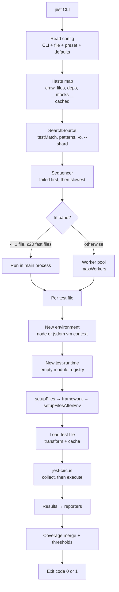

## 41.2 Hook order (Chapter 6, verified output)

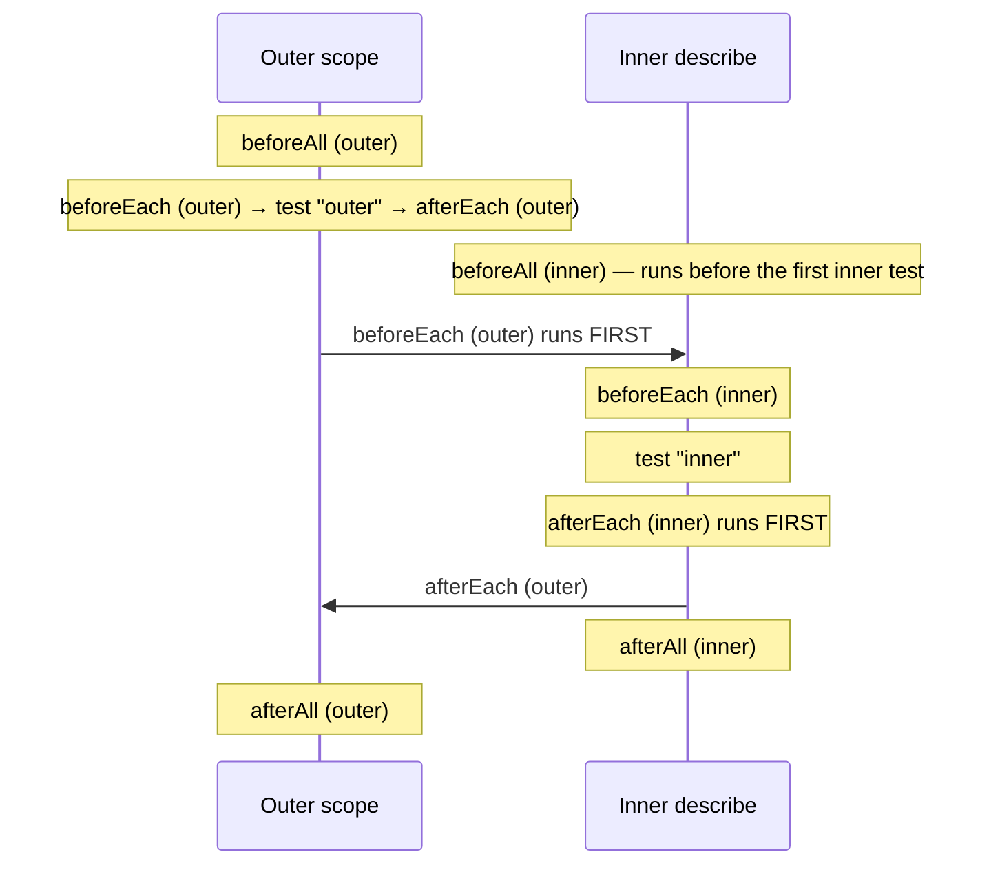

Rule: `before*` outer → inner; `after*` inner → outer.

## 41.3 Collection vs execution phase (Chapter 3 §3.4)

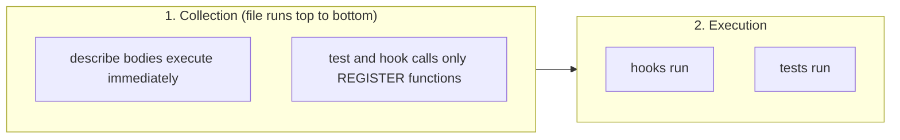

## 41.4 How `require` becomes a mock (Chapter 8, Chapter 21 §21.4)

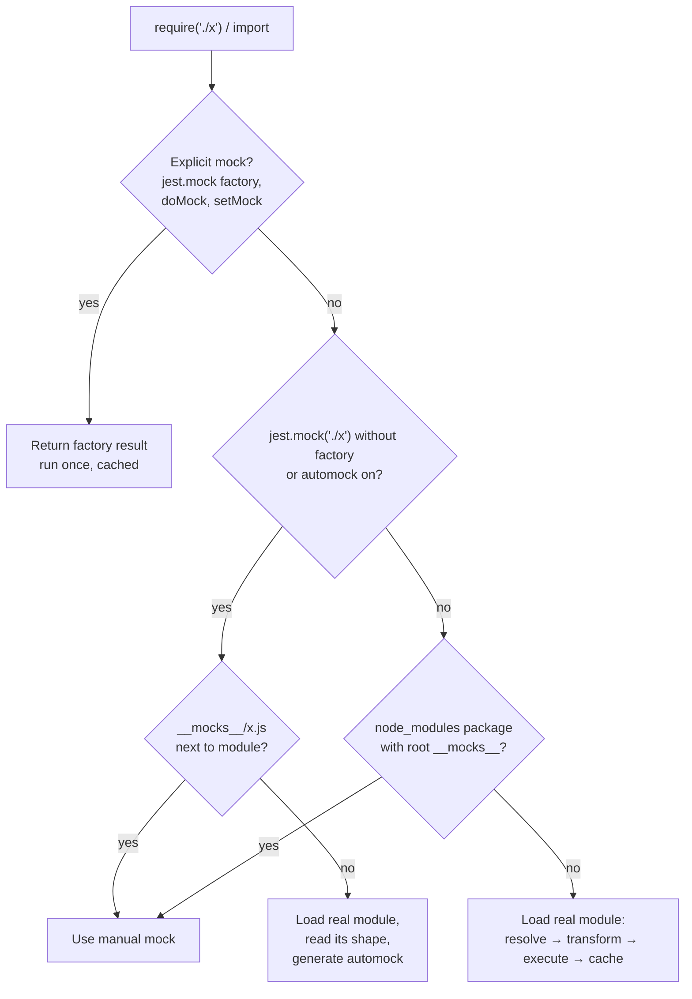

Babel hoists `jest.mock` above imports so the first box is configured before the import runs.

## 41.5 Choosing a mocking technique (Chapter 8 §8.11)

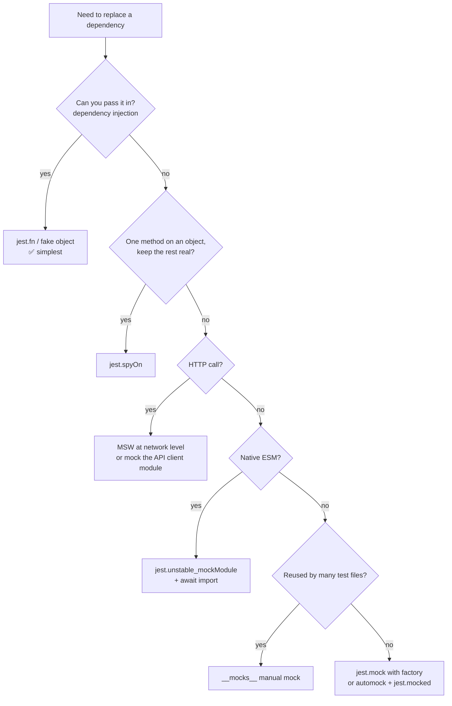

## 41.6 Clear vs reset vs restore (Chapter 7 §7.9, verified on Jest 30)

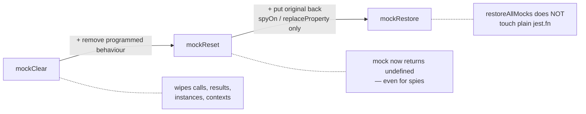

## 41.7 Fake timers and promises (Chapter 10 §10.5)

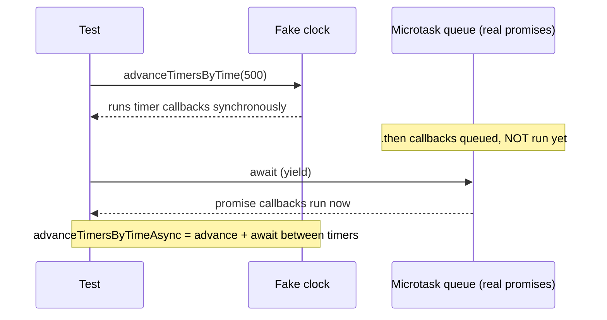

## 41.8 Transform pipeline and the ESM problem (Chapter 15)

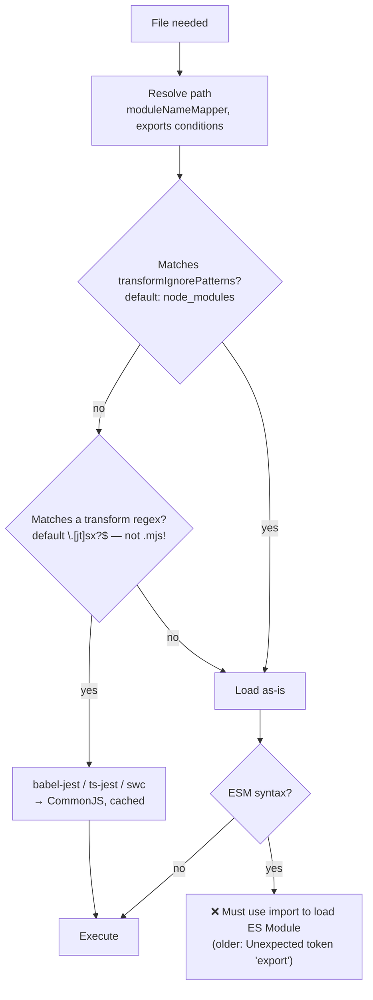

Fix for ERR: allow-list the package (`/node_modules/(?!(pkg)/)`, pnpm: `(?!(\.pnpm/)?(pkg))`),
widen `transform` to `\.[mc]?[jt]sx?$`, map to a CJS build, mock it, or use Node ≥ 24.9.

## 41.9 Test types and where Jest fits (Chapters 1, 39)

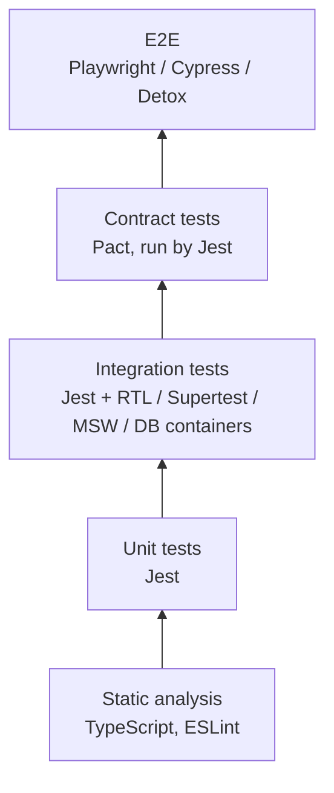

## 41.10 React Testing Library query choice (Chapter 16 §16.4)

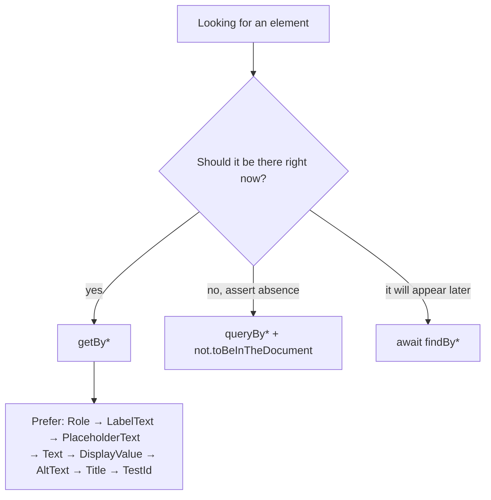

## 41.11 Debugging decision tree (Chapter 23)

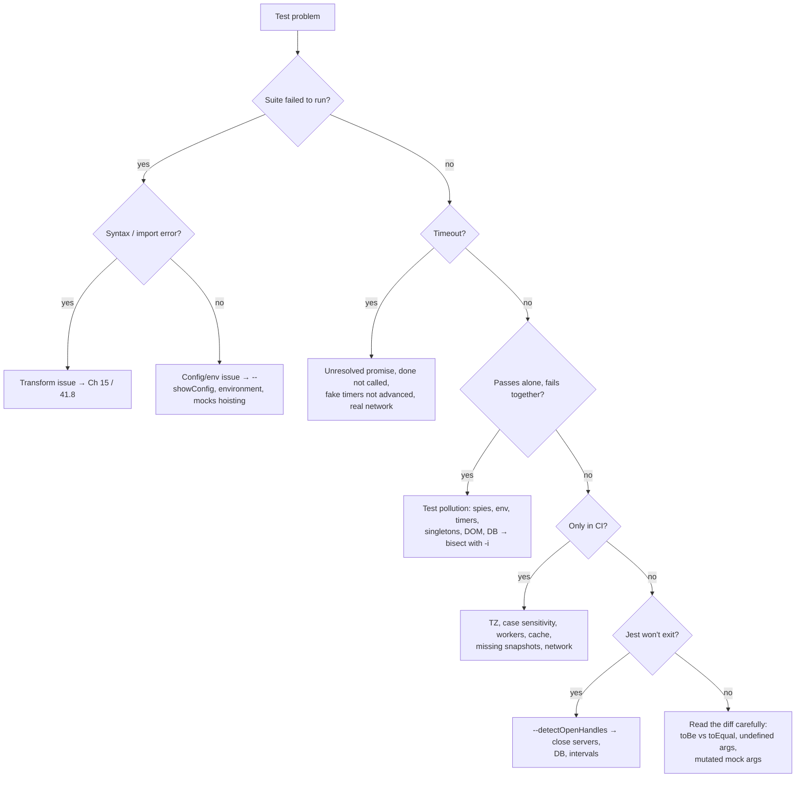

**Next:** [Chapter 42 — Interview questions for Part 7 topics](42-interview-ecosystem.md)
