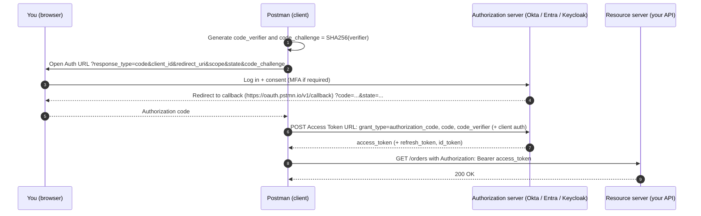
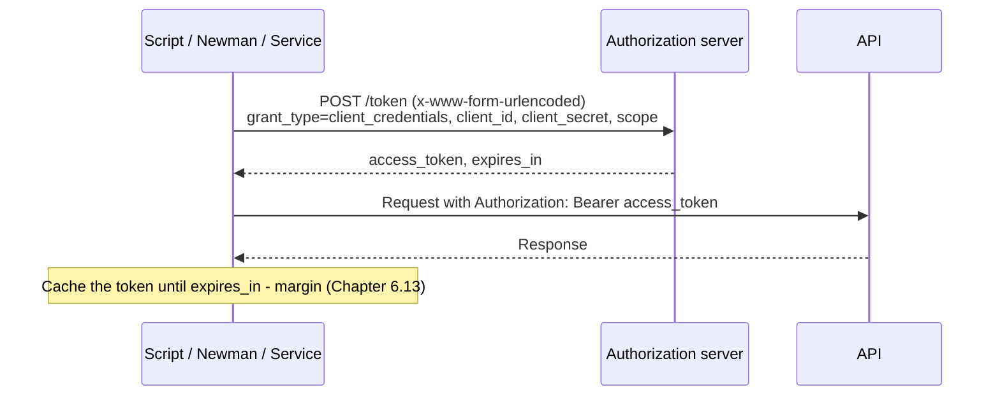

# Chapter 6 — Authorization & Authentication in Postman (Every Type, In Depth)

> 🧒 Every API is a **club with a guard**. Different clubs check you differently: some want a **secret password** (API key), some want a **wristband** they gave you earlier (token), some want you to **ask your parent** to sign a permission slip (OAuth), some want a **stamp that proves the letter wasn't changed** (signatures like AWS SigV4, Hawk, OAuth 1.0).

---

## 6.1 The Authorization tab

Every request, folder and collection has an **Authorization** tab with a **Type** dropdown:

| Type | Summary |
|---|---|
| **Inherit auth from parent** | Use folder/collection auth (default for new requests in collections) |
| **No Auth** | Send nothing |
| **API Key** | Key/value in header or query |
| **Bearer Token** | `Authorization: Bearer <token>` |
| **JWT Bearer** | Postman *generates & signs* a JWT for you |
| **Basic Auth** | `Authorization: Basic base64(user:pass)` |
| **Digest Auth** | Challenge–response with hashing |
| **OAuth 1.0** | Signed requests (Twitter/X legacy, some enterprise) |
| **OAuth 2.0** | Token flows (Authorization Code, PKCE, Client Credentials, Password, Implicit) |
| **Hawk Authentication** | HMAC-signed requests |
| **AWS Signature** | AWS SigV4 signing |
| **NTLM Authentication** | Windows/IIS challenge–response |
| **Akamai EdgeGrid** | Akamai APIs |
| **ASAP (Atlassian)** | Service-to-service JWT for Atlassian |

Postman builds the needed headers/params **at send time**. You can see the final result in the **Console** or the hidden headers.

> 🏢 **Best practice:** set auth **once at collection level** (`{{accessToken}}`), make every request **Inherit**, and only override for special requests (e.g. the login request itself = **No Auth**, negative tests = **No Auth** or a wrong token).

---

## 6.2 API Key

Fields: **Key**, **Value**, **Add to**: Header or Query Params.

```
Key:   X-API-Key
Value: {{vault:weather-api-key}}
Add to: Header
→ X-API-Key: 9f8e7d...
```
or Query → `?api_key=9f8e7d...`

Notes:
- Prefer **headers** — query strings end up in server logs, browser history, proxies.
- API keys identify an **application**, not usually a **user**.
- Test cases: missing key (401), invalid key (401/403), revoked key, key for wrong environment, key in wrong place.

---

## 6.3 Bearer Token

Field: **Token** → sends `Authorization: Bearer <token>`.

- "Bearer" = whoever **bears** (holds) the token gets access — so protect it like a password.
- Tokens are often **JWTs** or opaque random strings.
- Use `{{accessToken}}` and fill it automatically via a login script (6.13).

---

## 6.4 JWT — what it is and how Postman handles it

### Structure
`xxxxx.yyyyy.zzzzz` = **Header.Payload.Signature**, each **Base64URL**-encoded.
```json
// Header
{ "alg": "HS256", "typ": "JWT" }
// Payload (claims)
{ "sub": "user-42", "name": "Asha", "roles": ["admin"], "iat": 1767225600, "exp": 1767229200, "iss": "auth.shop.com", "aud": "orders-api" }
// Signature = HMACSHA256(base64url(header) + "." + base64url(payload), secret)
```
Standard claims: `iss` (issuer), `sub` (subject), `aud` (audience), `exp` (expiry, Unix seconds), `nbf` (not before), `iat` (issued at), `jti` (JWT ID).

> 🔑 JWT payload is **encoded, not encrypted**. Anyone can decode it (jwt.io). Never put passwords in a JWT. (Encrypted JWTs = **JWE**, a different thing.)

### Decode a JWT in a Postman script
```javascript
function decodeJwt(token) {
    const part = token.split(".")[1];
    const base64 = part.replace(/-/g, "+").replace(/_/g, "/")
                       .padEnd(part.length + (4 - part.length % 4) % 4, "=");
    return JSON.parse(atob(base64));
}
const claims = decodeJwt(pm.environment.get("accessToken"));
console.log(claims);
pm.test("Token has admin role", () => pm.expect(claims.roles).to.include("admin"));
pm.test("Token not expired", () => pm.expect(claims.exp * 1000).to.be.above(Date.now()));
```

### JWT Bearer auth type (Postman generates the JWT)
Fields: **Algorithm** (HS256/384/512, RS256/384/512, PS256/384/512, ES256/384/512), **Secret** (HMAC) or **Private key** (RSA/EC, paste or file), **Secret Base64 encoded** checkbox, **Payload** (JSON, variables allowed), **Advanced**: request header prefix (default `Bearer`), JWT headers (e.g. `kid`), add token to Header or Query param.
Use for services that accept **self-signed client JWTs** (e.g. service-to-service, Google service accounts style assertions, Apple APNs-style).

### JWT security tests you can do in Postman
- Change one character of signature → expect 401.
- Expired token (`exp` in past) → 401.
- `alg: none` token → must be rejected.
- Token for a different `aud` (other service) → must be rejected.
- Tamper payload role `user` → `admin` without re-signing → 401.

---

## 6.5 Basic Auth

Fields: **Username**, **Password** → `Authorization: Basic YXNoYTpzZWNyZXQ=` (= base64 of `asha:secret`).

- **Base64 is encoding, NOT encryption** — anyone can decode. Only safe over **HTTPS**.
- Manually: `btoa("asha:secret")` in a script.
- Restful-Booker accepts Basic `admin:password123` for PUT/DELETE as an alternative to the cookie token.

---

## 6.6 Digest Auth

How it works:
1. Client sends request without credentials.
2. Server replies `401` with `WWW-Authenticate: Digest realm="...", nonce="...", qop="auth", opaque="...", algorithm=MD5`.
3. Client hashes `username:realm:password`, method/URI and nonce into a response hash and resends.

Postman fields: Username, Password; Advanced: Realm, Nonce, Algorithm (MD5, MD5-sess, SHA-256, SHA-256-sess, SHA-512-256, SHA-512-256-sess), qop, Nonce Count, Client Nonce, Opaque. Postman by default **automatically performs the two-step handshake** (it extracts nonce/realm from the 401 and retries); a checkbox lets you **disable retrying** to see the raw 401.

Try: `GET https://httpbin.org/digest-auth/auth/user/passwd` with user/passwd.

---

## 6.7 OAuth 1.0

Every request is **signed** using consumer & token secrets.
Fields: **Signature Method** (HMAC-SHA1, HMAC-SHA256, HMAC-SHA512, RSA-SHA1, RSA-SHA256, RSA-SHA512, PLAINTEXT), **Consumer Key**, **Consumer Secret**, **Access Token**, **Token Secret**; Advanced: Callback URL, Verifier, Timestamp, Nonce, Version (1.0), Realm, **Include body hash**, **Add empty parameters to signature**; **Add authorization data to**: Request Body/URL or Request Headers.

Postman generates `oauth_nonce`, `oauth_timestamp`, `oauth_signature` each send.
Common bugs: **clock skew** (timestamp too far from server time → 401), wrong URL encoding of params in signature base string, body params not included when they should be.

---

## 6.8 OAuth 2.0 — The Big One

> 🧒 You want to let a **photo-printing app** use your **Google Photos**, but you don't want to give it your Google password. So Google gives the app a **special ticket** (access token) that only allows "read photos", only for a while. That's OAuth 2.0.

### Roles

| Role | Example |
|---|---|
| **Resource Owner** | You, the user |
| **Client** | The app (or Postman acting as the app) |
| **Authorization Server** | Google/Okta/Auth0/Keycloak/Azure AD (Entra ID) — issues tokens |
| **Resource Server** | The API that accepts tokens |

### Tokens
- **Access token** — short-lived (minutes–hours), sent with API calls.
- **Refresh token** — long-lived, used to get new access tokens without user login.
- **ID token** — (OpenID Connect) a JWT describing the **user's identity**; not meant for calling APIs.
- **Scopes** — permissions requested: `orders:read orders:write`.

### Grant types (flows) in Postman

**Authorization Code with PKCE**, the flow Postman runs when you click *Get New Access Token*:

**Client Credentials** (machine-to-machine, the one that works in CI):


| Grant type | Who uses it | Steps | Notes |
|---|---|---|---|
| **Authorization Code** | Web apps with a backend | Browser login → `code` → exchange code + client secret for token | Most common for user login |
| **Authorization Code (With PKCE)** | SPAs, mobile apps, and now recommended for **all** clients | Like above + `code_verifier`/`code_challenge` | OAuth 2.1 makes PKCE mandatory |
| **Implicit** | Old SPAs | Token returned directly in redirect URL fragment | **Deprecated** (insecure); avoid |
| **Password Credentials** (ROPC) | Legacy trusted first-party apps | Send username + password directly to token endpoint | **Deprecated** in OAuth 2.1; still common in internal test setups |
| **Client Credentials** | **Machine-to-machine** (service → service, cron jobs) | Send client_id + client_secret → token | No user involved; very common in microservices |

(Other grants exist outside Postman's dropdown — Device Code, Refresh Token, JWT Bearer assertion, Token Exchange — you can do them with a manual POST request.)

### Postman OAuth 2.0 configuration fields
**Current token** section:
- **Token** dropdown (select from stored tokens), **Header Prefix** (`Bearer`), **Add authorization data to**: Request Headers / Request URL, **Auto-refresh token** (uses refresh token when access token expires), **Share token** (share token with workspace collaborators — careful!).

**Configure New Token** section:

| Field | Meaning |
|---|---|
| Token Name | Label for this token in Postman's token manager |
| Grant Type | one of the five above |
| Callback URL | Redirect URI registered with the auth server. Tick **Authorize using browser** to use `https://oauth.pstmn.io/v1/callback` (register this in your IdP!) — Postman opens your system browser and receives the code |
| Auth URL | e.g. `https://login.example.com/oauth2/authorize` |
| Access Token URL | e.g. `https://login.example.com/oauth2/token` |
| Client ID / Client Secret | From your app registration (use `{{vault:...}}`) |
| Code Challenge Method | SHA-256 (recommended) or Plain — PKCE only |
| Code Verifier | Auto-generated if blank — PKCE only |
| Scope | Space-separated |
| State | Random anti-CSRF string |
| Client Authentication | **Send as Basic Auth header** or **Send client credentials in body** — must match what the server expects! |
| Advanced: Refresh Token URL, Auth Request params, Token Request params, Refresh Request params, `audience`, `resource` | Auth0 needs `audience`; Azure AD v1 uses `resource` |

Then **Get New Access Token** → login window/browser → token appears → **Use Token**.
**Manage tokens**: delete expired tokens, view details.

### Example: Client Credentials (Keycloak)
- Access Token URL: `https://keycloak.company.com/realms/shop/protocol/openid-connect/token`
- Client ID: `orders-service`
- Client Secret: `{{vault:orders-client-secret}}`
- Scope: `orders:read`
- Client Authentication: Send as Basic Auth header

### Example: Azure AD / Entra ID client credentials
- Token URL: `https://login.microsoftonline.com/{{tenantId}}/oauth2/v2.0/token`
- Scope: `api://{{apiAppId}}/.default`

### Common OAuth errors & fixes

| Error | Meaning | Fix |
|---|---|---|
| `invalid_client` | Wrong client id/secret, or wrong client-auth method (header vs body) | Toggle "Client Authentication"; re-copy secret (trailing space!) |
| `invalid_grant` | Code expired/used, wrong redirect URI, wrong user creds, refresh token revoked | Get a fresh code; check redirect URI matches exactly |
| `redirect_uri_mismatch` | Callback URL not registered | Register `https://oauth.pstmn.io/v1/callback` (or your exact URL) in IdP |
| `unauthorized_client` | Client not allowed that grant type | Enable grant in IdP app settings |
| `invalid_scope` | Scope not allowed/misspelled | Check IdP config |
| `unsupported_grant_type` | Typo or server doesn't support | Check `grant_type` value |
| Token works in Postman UI, fails in Newman | OAuth 2 "Get New Access Token" is **interactive**; Newman can't do the browser step | Use client credentials/password grant via a **script or setup request** in CI |
| 401 after ~1 hour | Access token expired | Auto-refresh, or script-based refresh (6.13) |
| Browser login window loops/blank | Cookies/SSO in embedded window | Use "Authorize using browser" |

---

## 6.9 Hawk Authentication
Fields: Hawk Auth ID, Hawk Auth Key, Algorithm (sha256/sha1); Advanced: User, Nonce, ext, app, dlg, Timestamp, **Include payload hash**. Produces an `Authorization: Hawk id="...", ts="...", nonce="...", mac="..."` header (HMAC over request parts). Clock skew matters.

---

## 6.10 AWS Signature (SigV4)
Fields: **AccessKey**, **SecretKey**, Advanced: **AWS Region** (e.g. `ap-south-1`), **Service Name** (e.g. `execute-api`, `s3`, `es`, `lambda`), **Session Token** (for temporary STS credentials), Add authorization data to: Request Headers / URL.

Postman computes `Authorization: AWS4-HMAC-SHA256 Credential=..., SignedHeaders=..., Signature=...` plus `X-Amz-Date`, `X-Amz-Content-Sha256` (S3), `X-Amz-Security-Token`.

Common errors:
- `SignatureDoesNotMatch` — wrong secret, wrong region/service, a header changed after signing, URL encoding differences.
- `The security token included in the request is expired` — refresh STS creds.
- `Signature expired: ... is now earlier than ...` — your machine clock is off.
- Use IAM users/roles with **least privilege** for testing.

---

## 6.11 NTLM
Fields: Username, Password; Advanced: Domain, Workstation. Used for Windows-integrated IIS / SharePoint / legacy .NET APIs. Postman performs the multi-step NTLM handshake. (Kerberos/Negotiate is not offered as a built-in type.)

## 6.12 Akamai EdgeGrid & ASAP
- **Akamai EdgeGrid**: Access Token, Client Token, Client Secret, Nonce, Timestamp, Base URL, Headers to Sign — for Akamai's control APIs.
- **ASAP (Atlassian Service Authentication Protocol)**: Algorithm, Issuer, Audience, Key ID, Private key, Subject, additional claims, expiry — Postman issues a signed JWT for service-to-service calls.

---

## 6.13 Automating login & token refresh (THE pattern every company uses)

### Pattern A — Login request + post-response script
Request `POST {{baseUrl}}/auth/login` (Auth: **No Auth**), body:
```json
{ "username": "{{username}}", "password": "{{password}}" }
```
Post-response script:
```javascript
pm.test("Login succeeded", () => pm.response.to.have.status(200));
const { accessToken, refreshToken, expiresIn } = pm.response.json();
pm.environment.set("accessToken", accessToken);
pm.environment.set("refreshToken", refreshToken);
pm.environment.set("accessTokenExpiresAt", Date.now() + (expiresIn - 30) * 1000); // 30s safety margin
```
Collection auth: Bearer `{{accessToken}}`.

### Pattern B — Collection-level pre-request script that fetches/refreshes a token only when needed (best for CI + manual)
```javascript
// Collection > Scripts > Pre-request
const tokenUrl   = pm.environment.get("tokenUrl");
const clientId   = pm.environment.get("clientId");
const clientSecret = pm.environment.get("clientSecret");
const expiresAt  = Number(pm.environment.get("accessTokenExpiresAt") || 0);
const token      = pm.environment.get("accessToken");

// Skip for the login/token request itself
if (pm.info.requestName === "Get access token") return;

if (token && Date.now() < expiresAt) {
    return; // still valid, nothing to do
}

pm.sendRequest({
    url: tokenUrl,
    method: "POST",
    header: { "Content-Type": "application/x-www-form-urlencoded" },
    body: {
        mode: "urlencoded",
        urlencoded: [
            { key: "grant_type", value: "client_credentials" },
            { key: "client_id", value: clientId },
            { key: "client_secret", value: clientSecret },
            { key: "scope", value: pm.environment.get("scope") || "" }
        ]
    }
}, (err, res) => {
    if (err) { console.error("Token request failed", err); return; }
    if (res.code !== 200) { console.error("Token endpoint returned", res.code, res.text()); return; }
    const body = res.json();
    pm.environment.set("accessToken", body.access_token);
    pm.environment.set("accessTokenExpiresAt", Date.now() + (body.expires_in - 30) * 1000);
    console.log("New token fetched, expires in", body.expires_in, "s");
});
```
Why this works: Postman **waits for `pm.sendRequest` callbacks to finish** before sending the main request, so the main request uses the new token.

> Note: `return` at the top level of a Postman script works because scripts run inside a function wrapper. If your linter complains, wrap logic in an `if/else` instead.

Async/await version — works in recent Postman **app** versions only (top-level `await`, promise-returning `pm.sendRequest`):
```javascript
const res = await pm.sendRequest({ url: pm.environment.get("tokenUrl"), method: "POST", /* ... */ });
pm.environment.set("accessToken", res.json().access_token);
```
**Newman 6.x does not support this** (verified: top-level `await` is a SyntaxError there). The callback version above was run successfully in Newman 6.2.3 — including the "fetch once, then reuse the cached token" behaviour — so prefer it for collections that run in CI.

### Pattern C — Retry once on 401 (post-response)
```javascript
if (pm.response.code === 401 && !pm.variables.get("_retried")) {
    pm.environment.unset("accessToken");           // force refresh in pre-request
    pm.variables.set("_retried", true);
    pm.execution.setNextRequest(pm.info.requestId); // rerun this request (Runner/CLI/Newman only)
}
```

---

## 6.14 Cookie/session-based auth and CSRF tokens

Flow (Django/Laravel/Spring Security style):
1. `GET /login` → server sets `csrftoken` cookie (or returns token in HTML/meta).
2. `POST /login` with header `X-CSRFToken: <value>` + form data → `Set-Cookie: sessionid=...`.
3. Subsequent requests carry the session cookie automatically + CSRF header for unsafe methods.

Script to copy CSRF cookie into header:
```javascript
// Pre-request of POST/PUT/DELETE requests
const csrf = pm.cookies.get("csrftoken");      // pm.cookies = cookies for the current request's domain
if (csrf) pm.request.headers.upsert({ key: "X-CSRFToken", value: csrf });
```
For programmatic jar access to other domains:
```javascript
const jar = pm.cookies.jar();
// The domain must be in the cookie allowlist (Cookies > Domains Allowlist)
jar.get("https://app.shop.com", "XSRF-TOKEN", (err, value) => {
    if (!err) pm.environment.set("xsrf", decodeURIComponent(value));
});
jar.set("https://app.shop.com", "feature_flag", "beta", (err, cookie) => {});
jar.unset("https://app.shop.com", "feature_flag", (err) => {});
jar.clear("https://app.shop.com", (err) => {});
```

Extract a token from HTML (e.g. hidden form field):
```javascript
const $ = cheerio.load(pm.response.text());
pm.environment.set("csrf", $('input[name="_token"]').val());
```

---

## 6.15 Mutual TLS (client certificates)
Settings → **Certificates** → **Add certificate**:
- **Host** (e.g. `api.bank.com`, wildcards like `*.bank.com` supported) and **Port** (default 443),
- **CRT file** + **KEY file** (PEM), **or** **PFX file**,
- **Passphrase**.
Postman sends the cert when the host matches. Newman: `--ssl-client-cert`, `--ssl-client-key`, `--ssl-client-passphrase`, or `--ssl-client-cert-list` (JSON list of host-matched certs). Postman CLI has similar options.

Errors: `socket hang up` / `ECONNRESET` / `alert handshake failure` → cert not sent (host/port mismatch), wrong format, cert not trusted by server, or expired.

---

## 6.16 Auth testing checklist (QA & security)
1. ✅ Valid credentials → 200.
2. ❌ No credentials → 401 (not 500, not 200!).
3. ❌ Invalid/expired/tampered token → 401.
4. ❌ Valid token, insufficient role/scope → 403.
5. ❌ User A's token accessing User B's resource → 403/404 (**BOLA/IDOR**).
6. ❌ Token in query string when only header allowed → rejected.
7. ❌ Brute-force login: multiple wrong passwords → lockout/429.
8. ✅ Logout invalidates token/session (server-side) → old token 401.
9. ✅ Refresh token rotation: old refresh token can't be reused.
10. ✅ Sensitive data not in responses (password hashes, secrets).
11. ✅ Error messages don't reveal whether username exists ("Invalid credentials" vs "User not found").
12. ✅ HTTPS enforced; HTTP redirected or refused.

---

## 6.17 Chapter 6 Quick Revision
- Set auth at collection level; requests inherit; override for login/negative tests.
- Basic = Base64 (not encryption). Bearer = holder gets access. JWT = header.payload.signature, encoded not encrypted.
- OAuth 2 grants: Auth Code (+PKCE recommended), Client Credentials (M2M), Password & Implicit deprecated.
- `https://oauth.pstmn.io/v1/callback` for browser-based auth in Postman.
- Interactive OAuth doesn't work in Newman → script-based token fetch.
- Pre-request token caching with expiry is the professional pattern.
- mTLS via Settings → Certificates.

➡️ Next: **Chapter 7 — Scripting in Postman (Complete `pm` API)**.
