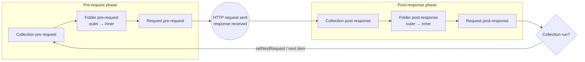

# Chapter 7 — Scripting in Postman: The Complete `pm` API

> 🧒 Scripts are **little helpers** you hire. A **pre-request helper** gets things ready *before* the letter is sent (writes today's date, fetches a key). A **post-response helper** reads the reply *after* it arrives and checks if it's correct, writes notes for the next letter, and shouts if something's wrong.

---

## 7.1 Where scripts live

| Location | Pre-request | Post-response |
|---|---|---|
| Collection | ✅ | ✅ |
| Folder | ✅ | ✅ |
| Request | ✅ | ✅ |

UI: **Scripts** tab → **Pre-request** / **Post-response** (older UI: "Pre-request Script" tab and "Tests" tab — same thing). In exported JSON: `"listen": "prerequest"` and `"listen": "test"`.

## 7.2 Execution order (memorise this!)




For one request inside `Collection > Folder A > Folder B > Request`:

```
1. Collection  pre-request
2. Folder A    pre-request
3. Folder B    pre-request
4. Request     pre-request
5. ──► HTTP request is sent, response received ◄──
6. Collection  post-response
7. Folder A    post-response
8. Folder B    post-response
9. Request     post-response
```

- In a Collection Run this cycle repeats for **every request**, for **every iteration**.
- Collection/folder scripts therefore run **once per request**, not once per run. To do something only once per run, guard it:
```javascript
// Collection pre-request — run only before the first request of the first iteration
if (pm.info.iteration === 0 && !pm.variables.get("_initDone")) {
    pm.variables.set("_initDone", true);   // local: lives for the whole run
    console.log("One-time setup");
}
```
> (Local variables set with `pm.variables.set` persist for the duration of a collection run, so this flag works in Runner/Newman. For a single manual send, it's per request.)

---

## 7.3 The Sandbox — what scripts can and can't do

Postman scripts run in the **Postman Sandbox**, a JavaScript runtime (ES6+/modern JS) based on Node.js but restricted.

✅ You can:
- Use modern JS: `let/const`, arrow functions, template literals, destructuring, classes, `async/await`, Promises, `Map/Set`, optional chaining `?.`, nullish `??`.
- Use `setTimeout`/`setInterval`/`clearTimeout` (the run waits for pending timers).
- Make HTTP calls with `pm.sendRequest`.
- `require()` a fixed list of built-in libraries (7.15) and `pm.require()` packages from the **Package Library** (7.16).
- `console.log/info/warn/error` → **Postman Console**.

❌ You can't:
- Access the file system (`fs`), spawn processes, open sockets directly.
- Access the DOM/`window`/`document` (no browser). (Only Visualizer templates run in a browser-like frame.)
- `require` arbitrary npm packages directly (use Package Library / supported external registries instead).
- Share JS variables between requests — each script has its own scope. **Use Postman variables** to pass data.

---

## 7.4 `pm.info` — where am I?

```javascript
pm.info.eventName;       // "prerequest" or "test" (post-response)
pm.info.iteration;       // current iteration index, starts at 0
pm.info.iterationCount;  // total iterations in this run
pm.info.requestName;     // name of the request
pm.info.requestId;       // unique id of the request
```
Usage: one shared collection-level script that behaves differently per event:
```javascript
if (pm.info.eventName === "prerequest") { /* ... */ } else { /* post-response */ }
```

---

## 7.5 `pm.request` — read and modify the request (pre-request) or inspect it (post-response)

```javascript
pm.request.method;                  // "POST"
pm.request.url.toString();          // full URL (variables may be unresolved here)
pm.request.url.getHost();           // "api.shop.com" (or "{{baseUrl}}" if unresolved)
pm.request.url.getPath();           // "/v1/orders"
pm.request.url.query.toObject();    // { page: "1" }
pm.request.headers.toObject();      // { accept: "application/json", ... }
pm.request.headers.get("Accept");
pm.request.body;                    // RequestBody object: mode, raw, urlencoded, formdata, file, graphql
pm.request.auth;                    // auth definition
```

### Modify (pre-request only — changes affect what's sent)
```javascript
// Headers
pm.request.headers.add({ key: "X-Correlation-ID", value: pm.variables.replaceIn("{{$guid}}") });
pm.request.headers.upsert({ key: "Accept-Language", value: "en-IN" }); // add or replace
// Note: add() does NOT replace — if the header already exists you send it twice
// (servers usually see "X-A: 1, 2"). Use upsert() when a collection script may already have set it.
pm.request.headers.remove("X-Debug");

// Query params
pm.request.url.query.add({ key: "ts", value: Date.now().toString() });
pm.request.url.query.upsert({ key: "page", value: "2" });
pm.request.url.query.remove("debug");

// Change the URL entirely
pm.request.url = pm.variables.replaceIn("{{baseUrl}}/v2/orders");

// Change method
pm.request.method = "PUT";

// Modify a raw JSON body
const body = JSON.parse(pm.request.body.raw || "{}");
body.requestedAt = new Date().toISOString();
pm.request.body.raw = JSON.stringify(body);

// ⚠️ If the request was saved WITHOUT a body (e.g. a GET), pm.request.body is undefined,
// so pm.request.body.update(...) throws "Cannot read properties of undefined (reading 'update')".
// Assigning a plain object works in that case (verified in Newman 6):
// pm.request.body = { mode: "raw", raw: JSON.stringify({ a: 1 }), options: { raw: { language: "json" } } };

// Or replace an existing body using update()
pm.request.body.update({
    mode: "raw",
    raw: JSON.stringify({ hello: "world" }),
    options: { raw: { language: "json" } }
});

// urlencoded body
pm.request.body.urlencoded.add({ key: "grant_type", value: "client_credentials" });
```

> ⚠️ `pm.request.body.raw` contains **unresolved** `{{variables}}`. If you `JSON.parse` a body like `{"age": {{age}}}` it throws (invalid JSON). Use `JSON.parse(pm.variables.replaceIn(pm.request.body.raw))` to parse after resolving.

### Example: HMAC request signing (very common in fintech)
```javascript
// Pre-request: sign body with HMAC-SHA256 and add headers
const secret = pm.environment.get("hmacSecret");
const ts = Math.floor(Date.now() / 1000).toString();
const body = pm.variables.replaceIn(pm.request.body.raw || "");
const path = pm.request.url.getPathWithQuery();
const payload = `${ts}\n${pm.request.method}\n${path}\n${body}`;
const signature = CryptoJS.HmacSHA256(payload, secret).toString(CryptoJS.enc.Hex);

pm.request.headers.upsert({ key: "X-Timestamp", value: ts });
pm.request.headers.upsert({ key: "X-Signature", value: signature });
```
(`CryptoJS` is available globally, or via `require("crypto-js")`.)

> Tip: if the body you sign must be **byte-identical** to what's sent, set the final resolved body back: `pm.request.body.raw = body;` so Postman doesn't re-serialise differently.

---

## 7.6 `pm.response` — the response (post-response scripts)

```javascript
pm.response.code;            // 200
pm.response.status;          // "OK"
pm.response.responseTime;    // ms (number)
pm.response.responseSize;    // bytes
pm.response.headers;         // HeaderList
pm.response.headers.get("Content-Type");   // case-insensitive
pm.response.headers.has("ETag");
pm.response.headers.toObject();
pm.response.cookies;         // CookieList from this response (⚠️ found EMPTY in Newman 6 — use pm.cookies or parse Set-Cookie headers)
pm.response.text();          // body as string
pm.response.json();          // body parsed as JSON (throws if not JSON!)
```

Safe JSON parsing:
```javascript
let json;
try {
    json = pm.response.json();
} catch (e) {
    pm.test("Response is valid JSON", () => { throw new Error("Body is not JSON: " + pm.response.text().slice(0, 200)); });
}
```

XML response:
```javascript
const obj = xml2Json(pm.response.text());   // legacy global, still available
// or
const xml2js = require("xml2js");
xml2js.parseString(pm.response.text(), { explicitArray: false }, (err, result) => {
    pm.test("Has user name", () => pm.expect(result.user.name).to.eql("Asha"));
});
```

HTML response:
```javascript
const $ = cheerio.load(pm.response.text());
pm.test("Title is correct", () => pm.expect($("title").text()).to.include("Dashboard"));
```

---

## 7.7 Variables API (recap — full details in Chapter 5)

```javascript
pm.variables.get/set/has/replaceIn/toObject        // resolved / local
pm.environment.get/set/has/unset/clear/toObject/name/replaceIn
pm.collectionVariables.get/set/has/unset/clear/toObject/replaceIn
pm.globals.get/set/has/unset/clear/toObject/replaceIn
pm.iterationData.get/has/toObject                  // read-only data file row
await pm.vault.get/set/unset                       // secrets (async)
```

---

## 7.8 `pm.sendRequest` — call other APIs from a script

Use for: fetching tokens, creating prerequisite data, cleanup, polling, verifying side effects (e.g. "after POST /order, GET /inventory decreased").

### Simple GET
```javascript
pm.sendRequest("https://postman-echo.com/get?x=1", (err, res) => {
    if (err) return console.error(err);
    console.log(res.code, res.json());
});
```

### Full request object
```javascript
pm.sendRequest({
    url: pm.variables.replaceIn("{{baseUrl}}/inventory/{{sku}}"),
    method: "GET",
    header: {
        "Authorization": "Bearer " + pm.environment.get("accessToken"),
        "Accept": "application/json"
    }
}, (err, res) => {
    pm.test("Inventory decreased after order", () => {
        pm.expect(err).to.be.null;
        pm.expect(res.json().available).to.eql(Number(pm.environment.get("stockBefore")) - 1);
    });
});
```

### POST with JSON body
```javascript
pm.sendRequest({
    url: pm.variables.replaceIn("{{baseUrl}}/customers"),
    method: "POST",
    header: { "Content-Type": "application/json" },
    body: { mode: "raw", raw: JSON.stringify({ name: "Test User", email: `qa+${Date.now()}@example.com` }) }
}, (err, res) => {
    pm.environment.set("customerId", res.json().id);
});
```
Body modes: `raw`, `urlencoded` (array of `{key,value}`), `formdata` (array of `{key,value,type}`; file uploads from sendRequest are limited), `file`, `graphql` (`{ query, variables }`).

### Promise / async-await
Recent Postman **app** versions support top-level `await` and `pm.sendRequest` returning a promise when no callback is passed:
```javascript
const res = await pm.sendRequest({ url: "https://postman-echo.com/get", method: "GET" }); // Postman app (recent) only
```
⚠️ **Verified while writing this book: Newman 6.2.3 rejects top-level `await`** (`SyntaxError: await is only valid in async functions...`) and its `pm.sendRequest` does **not** return a promise. If your collection also runs in Newman, use this portable pattern:
```javascript
// Works in the Postman app AND in Newman 6 (verified): wrap the callback API in a Promise
const sendRequestAsync = (req) => new Promise((resolve, reject) =>
    pm.sendRequest(req, (err, res) => err ? reject(err) : resolve(res)));

(async () => {
    const r1 = await sendRequestAsync(pm.variables.replaceIn("{{baseUrl}}/users/3"));
    const r2 = await sendRequestAsync(pm.variables.replaceIn("{{baseUrl}}/users/" + r1.json().id));
    pm.test("chained calls work", () => pm.expect(r2.code).to.eql(200));
})().catch(err => pm.test("async block failed", () => { throw err; }));
```

### Parallel requests
```javascript
const ids = [1, 2, 3];
let done = 0;
ids.forEach(id => {
    pm.sendRequest(`https://jsonplaceholder.typicode.com/users/${id}`, (err, res) => {
        pm.test(`User ${id} exists`, () => pm.expect(res.code).to.eql(200));
        done++;
    });
});
// Postman waits for all callbacks before finishing the script.
```

Important facts:
- `pm.sendRequest` calls are **not** shown as separate items in Runner results, but **are** in the Console.
- They **do not** inherit the collection's auth or headers automatically — add them yourself.
- They don't run that request's scripts (it's a raw call).
- Variables inside the URL string are **not auto-resolved** — use `pm.variables.replaceIn()`.
- The **cookie jar** is shared, so `Set-Cookie` from a `sendRequest` may affect later requests.

---

## 7.9 `pm.execution` — control the run

```javascript
pm.execution.setNextRequest("Request name or ID");  // jump (Runner/Newman/CLI only)
pm.execution.setNextRequest(null);                  // stop the run after this request
pm.execution.skipRequest();                          // pre-request only: don't send this request
pm.execution.location;                               // array path e.g. ["My Collection","Folder","Request"]
pm.execution.location.current;                       // the current item's name/location in the path
```
- `setNextRequest` works in **pre-request or post-response**; the **last value set wins**; it only applies to **collection runs** (no effect on a single manual Send).
- The target must be in the **same collection run** (if you run only a folder, it must be within that run's scope).
- Prefer **request ID** (`pm.info.requestId` of the target, or copy from the request info pane) over **name** — names change and can be duplicated.
- Legacy equivalent: `postman.setNextRequest("name")` — still works in many versions; prefer `pm.execution.setNextRequest`.
- `skipRequest()` **must** be in **pre-request**; in post-response it throws `TypeError: pm.execution.skipRequest is not a function` (exact message verified in Newman 6). When skipped, the request and its post-response scripts don't run.

Full workflow patterns in Chapter 9.

---

## 7.10 `pm.cookies`
```javascript
pm.cookies.has("sessionId");
pm.cookies.get("sessionId");
pm.cookies.toObject();
const jar = pm.cookies.jar();   // programmatic jar (domains must be allowlisted)
jar.get(url, name, cb); jar.getAll(url, cb); jar.set(url, name, value, cb); jar.set(url, {name, value, httpOnly:true}, cb);
jar.unset(url, name, cb); jar.clear(url, cb);
```

---

## 7.11 `pm.test` and `pm.expect` (testing — full chapter next)
```javascript
pm.test("Status is 201", function () {
    pm.response.to.have.status(201);
});
pm.test("Has order id", () => {
    const json = pm.response.json();
    pm.expect(json).to.have.property("id");
    pm.expect(json.id).to.be.a("number");
});
pm.test.skip("Not ready yet", () => {});   // shows as skipped
```
- A test **passes** if the function doesn't throw. Any thrown error/failed assertion = **fail**.
- One failing test doesn't stop other tests or the run (unless `--bail`).
- `pm.expect` = **Chai** `expect` (BDD style).

---

## 7.12 `pm.visualizer` — custom visual responses

```javascript
const template = `
<style>
  table { border-collapse: collapse; font-family: sans-serif; }
  td, th { border: 1px solid #ccc; padding: 6px 10px; }
  .inactive { color: #b00; }
</style>
<h3>Users ({{users.length}})</h3>
<table>
  <tr><th>ID</th><th>Name</th><th>Email</th><th>City</th></tr>
  {{#each users}}
    <tr><td>{{id}}</td><td>{{name}}</td><td>{{email}}</td><td>{{address.city}}</td></tr>
  {{/each}}
</table>`;

pm.visualizer.set(template, { users: pm.response.json() });
```
Run against `https://jsonplaceholder.typicode.com/users` → **Visualize** tab shows a table.

- Templates use **Handlebars** syntax.
- You can load external JS libraries in the template (e.g. Chart.js via `<script src="https://cdn.jsdelivr.net/npm/chart.js"></script>`) and access data inside the template's script via:
```html
<script>
  pm.getData(function (err, data) {
      // data = the object you passed to pm.visualizer.set
  });
</script>
```
- `pm.visualizer.clear()` (newer versions) removes the visualization.
- Use cases: charts of response times, tables for large arrays, rendering images/base64, comparing environments.

---

## 7.13 Console logging (debugging)
```javascript
console.log("Order id:", pm.environment.get("orderId"));
console.info("Info"); console.warn("Careful"); console.error("Bad");
console.log(pm.request.toJSON());    // whole request object
console.log(pm.response.headers.toObject());
console.clear();                     // clear console (where supported)
```
Console shows: **each request** (incl. `pm.sendRequest`), **request headers & body actually sent**, **response headers & body**, **network info**, **script logs and errors**. In Newman logs go to stdout (unless reporter options hide them).

---

## 7.14 Error handling inside scripts
- A **runtime error** in a post-response script → shown as an error ("There was an error in evaluating the test script"), remaining code in that script stops, tests defined before still count.
- Wrap risky code in `try/catch` or inside `pm.test` (an error inside `pm.test` becomes a failed test instead of a script crash — **preferred**).
```javascript
pm.test("Items have prices", () => {
    const items = pm.response.json().items;   // if undefined, test fails nicely
    items.forEach(i => pm.expect(i.price).to.be.above(0));
});
```

---

## 7.15 Built-in libraries available via `require()`

| Library | Use | Example |
|---|---|---|
| `lodash` (also global `_`) | Utility functions | `_.get(json, "a.b[0].c")`, `_.uniqBy`, `_.isEqual` |
| `moment` | Dates | `moment().add(1, "days").format("YYYY-MM-DD")` |
| `crypto-js` (global `CryptoJS`) | Hashing, HMAC, AES, Base64 | `CryptoJS.SHA256("x").toString()` |
| `ajv` | **JSON Schema validation** (draft-07 by default; newer drafts via options) | Chapter 8 |
| `tv4` | Older JSON Schema validator (draft-04) — **deprecated**, prefer ajv | |
| `chai` | Assertions (`pm.expect` is Chai) | |
| `cheerio` | jQuery-like HTML parsing | `cheerio.load(html)` |
| `uuid` | UUIDs | `require("uuid").v4()` |
| `xml2js` | XML ↔ JS | |
| `csv-parse/lib/sync` | Parse CSV text | `parse(text, { columns: true })` |
| `postman-collection` | Postman SDK objects | `new (require("postman-collection").Url)(...)` |
| `atob`, `btoa` | Base64 decode/encode (globals) | |
| Node built-ins | `path`, `assert`, `buffer`, `util`, `url`, `punycode`, `querystring`, `string_decoder`, `stream`, `timers`, `events` | `require("url")` |

Also available as globals without `require`: `_` (lodash), `CryptoJS`, `cheerio`, `tv4`, `xml2Json`, `atob`, `btoa`, `console`, `setTimeout`/`setInterval`. For `Buffer`, use `require("buffer").Buffer` to be safe across versions.

Examples:
```javascript
const moment = require("moment");
pm.variables.set("checkin", moment().add(7, "days").format("YYYY-MM-DD"));

// `_` is already a global — `const _ = require("lodash")` throws "Identifier '_' has already been declared"
const lodash = require("lodash");   // or just use the global _
const json = pm.response.json();
const city = lodash.get(json, "data.user.address.city", "N/A");

const parse = require("csv-parse/lib/sync");
const rows = parse(pm.response.text(), { columns: true, skip_empty_lines: true });
pm.test("CSV has 10 rows", () => pm.expect(rows).to.have.lengthOf(10));

const sha = CryptoJS.SHA256("hello").toString(CryptoJS.enc.Hex);
const b64 = CryptoJS.enc.Base64.stringify(CryptoJS.enc.Utf8.parse("hello")); // "aGVsbG8="
```

---

## 7.16 Package Library and `pm.require` (reusable code)

**Problem:** Same helper (token refresh, schema validation, common assertions) copied into 40 collections. Fix one bug → 40 edits.

**Old workarounds:** store functions as strings in variables and `eval()` them (fragile, insecure), or put helpers in a collection-level script (only that collection).

**Postman's solution (v11+): the Package Library.**
1. In a workspace's **Package Library** (from the Scripts editor → "Open package library"), create a package e.g. `@shop/test-utils`.
2. Write a module with `module.exports`:
```javascript
// Package: @shop/test-utils
function expectStatus(code) {
    pm.test(`Status is ${code}`, () => pm.response.to.have.status(code));
}
function expectJsonContentType() {
    pm.test("Content-Type is JSON", () =>
        pm.expect(pm.response.headers.get("Content-Type")).to.include("application/json"));
}
function expectFasterThan(ms) {
    pm.test(`Response time < ${ms}ms`, () => pm.expect(pm.response.responseTime).to.be.below(ms));
}
module.exports = { expectStatus, expectJsonContentType, expectFasterThan };
```
3. Use anywhere in your team:
```javascript
const utils = pm.require("@shop/test-utils");
utils.expectStatus(200);
utils.expectJsonContentType();
utils.expectFasterThan(800);
```
- Packages are versioned/edited centrally; changes reflect everywhere.
- Recent versions also let `pm.require` load packages from **external registries** such as npm (syntax like `pm.require('npm:package-name@version')`) — check your version's docs; pin versions for reproducibility.
- In CI, Newman/Postman CLI need access to these packages — the Postman CLI (logged in) resolves team packages; for Newman, verify support in your version or keep helpers inline/collection-level.

---

## 7.17 Legacy script syntax (you WILL see this in old company collections)

| Old (deprecated) | New |
|---|---|
| `tests["Status is 200"] = responseCode.code === 200;` | `pm.test("Status is 200", () => pm.response.to.have.status(200));` |
| `responseBody` | `pm.response.text()` |
| `JSON.parse(responseBody)` | `pm.response.json()` |
| `responseCode.code` | `pm.response.code` |
| `responseTime` | `pm.response.responseTime` |
| `responseHeaders["Content-Type"]` / `postman.getResponseHeader("Content-Type")` | `pm.response.headers.get("Content-Type")` |
| `postman.setEnvironmentVariable("k", v)` | `pm.environment.set("k", v)` |
| `postman.getEnvironmentVariable("k")` / `environment.k` | `pm.environment.get("k")` |
| `postman.setGlobalVariable` / `globals.k` | `pm.globals.set` / `pm.globals.get` |
| `postman.clearEnvironmentVariable("k")` | `pm.environment.unset("k")` |
| `postman.setNextRequest("x")` | `pm.execution.setNextRequest("x")` |
| `data.email` (iteration data) | `pm.iterationData.get("email")` |
| `request.url`, `request.headers` | `pm.request.url`, `pm.request.headers` |
| `tv4.validate(json, schema)` | `pm.response.to.have.jsonSchema(schema)` or ajv |

> 🏢 **Migration task in companies:** "Modernise legacy collection scripts." Do it folder by folder, run the collection before/after, compare results.

---

## 7.18 Script snippets panel
Next to the script editor, Postman offers **snippets** (click to insert): "Get an environment variable", "Set a global variable", "Send a request", "Status code: Code is 200", "Response body: JSON value check", "Response time is less than 200ms", "Response headers: Content-Type header check", "Use Tiny Validator for JSON data" (old) etc. Great for beginners; but learn to write them yourself for interviews.

Also: **Postbot / Agent Mode** can generate tests ("Add tests for this response", "Fix this test", "Visualize response as table").

---

## 7.19 Practical script recipes

### Save an ID from a create response
```javascript
pm.test("Created", () => pm.response.to.have.status(201));
const id = pm.response.json().id;
pm.collectionVariables.set("orderId", id);
```

### Save a value from a response header (e.g., Location)
```javascript
const location = pm.response.headers.get("Location");      // "/orders/987"
pm.collectionVariables.set("orderId", location.split("/").pop());
```

### Find an item in an array
```javascript
const users = pm.response.json();
const asha = users.find(u => u.username === "Asha");
pm.test("Asha exists", () => pm.expect(asha, "user Asha").to.exist);
pm.environment.set("ashaId", asha.id);
```

### Extract with regex from text
```javascript
const match = pm.response.text().match(/Order number: (\w+)/);
if (match) pm.environment.set("orderNo", match[1]);
```

### Wait / delay (polling helper)
```javascript
setTimeout(() => {}, 2000);   // the script (and next request) waits ~2s
```

### Conditional test by environment
```javascript
if (pm.environment.name.includes("PROD")) {
    pm.test("No debug fields in prod", () => pm.expect(pm.response.json()).to.not.have.property("debug"));
}
```

### Remove empty params before sending
```javascript
pm.request.url.query.each(q => { if (!q.value) pm.request.url.query.remove(q.key); });
```

### Compute a date range
```javascript
const today = new Date();
const from = new Date(today.getTime() - 7 * 86400000).toISOString().slice(0, 10);
pm.variables.set("fromDate", from);
pm.variables.set("toDate", today.toISOString().slice(0, 10));
```

### Generate unique, traceable test data
```javascript
const runId = pm.variables.get("_runId") || Date.now().toString(36);
pm.variables.set("_runId", runId);
pm.variables.set("email", `qa+${runId}-${pm.info.iteration}@example.com`);
```

---

## 7.20 Script quality rules (company standards)
1. **Put shared logic high** (collection/folder) and request-specific logic low.
2. **No secrets hardcoded** in scripts. Read from variables/Vault.
3. **Name tests clearly**: `"POST /orders → 201 and returns id"`, not `"test1"`.
4. **Wrap parsing in tests** so failures are reported, not crashes.
5. **Avoid `pm.environment.clear()`/`pm.globals.clear()`** in shared collections.
6. **Clean up** variables you create (`unset`) in teardown.
7. **Log meaningfully** but don't log tokens/PII (Console logs can be shared in screenshots, CI logs are stored).
8. **Prefer IDs over names** for `setNextRequest`.
9. **Use Package Library** for reused helpers.
10. **Keep scripts short**; if a script is 200 lines, it's an app — refactor.

---

## 7.21 Chapter 7 Quick Revision
- Order: Collection → Folder(s) → Request for both pre-request and post-response.
- Sandbox: modern JS, no fs/DOM, limited `require`, `pm.require` for team packages.
- `pm.request` modifiable in pre-request; `pm.response` in post-response.
- `pm.sendRequest` for side calls (no auto auth, no auto variable resolution).
- `pm.execution.setNextRequest` / `skipRequest` control runs.
- Visualizer = Handlebars template + `pm.getData`.
- Legacy `tests[]`, `responseBody`, `postman.*` → migrate to `pm.*`.

➡️ Next: **Chapter 8 — Testing and Assertions in Depth**.
