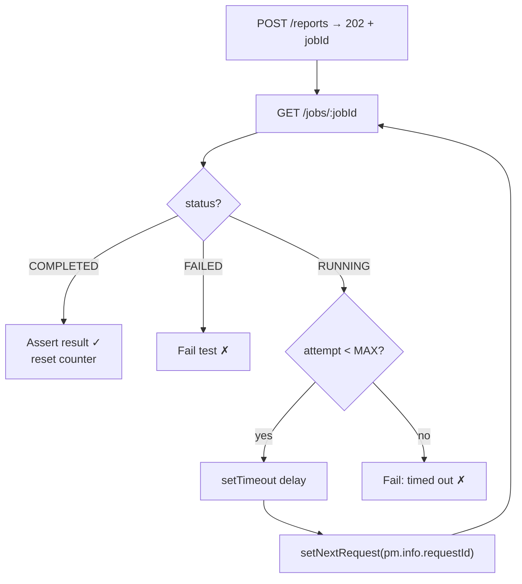

# Chapter 9 — Request Chaining and Workflows

> 🧒 **Chaining** is a **relay race**. Runner 1 (Login) passes the baton (token) to Runner 2 (Create Order), who passes a new baton (orderId) to Runner 3 (Pay), and so on. The baton is a **variable**.

---

## 9.1 Basic chaining with variables

1. **Request A** (post-response): extract value → save to variable.
2. **Request B**: use `{{variable}}` in URL/header/body.

```javascript
// POST /orders → post-response
const order = pm.response.json();
pm.collectionVariables.set("orderId", order.id);
pm.collectionVariables.set("orderTotal", order.total);
```
```
POST {{baseUrl}}/payments
{ "orderId": "{{orderId}}", "amount": {{orderTotal}} }
```

### Which scope to store chained values in?

| Scope | Pros | Cons |
|---|---|---|
| **Collection variable** | Travels with collection; independent of environment | Shared across environments (stale value when switching env) |
| **Environment variable** | Env-specific (QA orderId ≠ DEV orderId) | Pollutes env with runtime junk |
| **Local (`pm.variables.set`)** | Clean; disappears after run | Not visible across separate manual sends |

**Common company convention:** config in **environment**, runtime IDs in **collection variables** (or environment with a `_` prefix), and clean them up in a teardown folder.

---

## 9.2 Default execution order & controlling it

- Runner executes requests **top to bottom** (depth-first through folders).
- `pm.execution.setNextRequest(nameOrId)` changes **which request runs next**.
- `pm.execution.setNextRequest(null)` **stops** the run after the current request.
- `pm.execution.skipRequest()` (pre-request) **skips** the current request.
- These only affect **collection runs** (Runner, Newman, Postman CLI, monitors, scheduled runs) — **not** a single manual Send.

---

## 9.3 Workflow patterns

### Pattern 1: Conditional branching
```javascript
// "Get user" post-response
const user = pm.response.json();
if (user.kycStatus === "VERIFIED") {
    pm.execution.setNextRequest("Create loan application");
} else {
    pm.execution.setNextRequest("Submit KYC documents");
}
```

### Pattern 2: Loop over a list from a response
```javascript
// "List products" post-response
const ids = pm.response.json().map(p => p.id);
pm.collectionVariables.set("productIds", JSON.stringify(ids));
```
```javascript
// "Get product details" pre-request
let ids = JSON.parse(pm.collectionVariables.get("productIds") || "[]");
if (ids.length === 0) { pm.execution.skipRequest(); return; }
const current = ids.shift();
pm.collectionVariables.set("productId", current);
pm.collectionVariables.set("productIds", JSON.stringify(ids));
```
```javascript
// "Get product details" post-response
pm.test(`Product ${pm.collectionVariables.get("productId")} OK`, () => pm.response.to.have.status(200));
const remaining = JSON.parse(pm.collectionVariables.get("productIds"));
if (remaining.length > 0) {
    pm.execution.setNextRequest(pm.info.requestId);   // run this request again
} else {
    pm.collectionVariables.unset("productIds");       // loop finished → continue normally
}
```

### Pattern 3: Pagination — fetch all pages
```javascript
// "List orders" (GET {{baseUrl}}/orders?page={{page}}&limit=50)
// pre-request
if (!pm.collectionVariables.get("page")) pm.collectionVariables.set("page", 1);

// post-response
const body = pm.response.json();
let all = JSON.parse(pm.collectionVariables.get("_allOrders") || "[]");
all = all.concat(body.data);
pm.collectionVariables.set("_allOrders", JSON.stringify(all));

if (body.hasMore /* or body.page < body.totalPages */) {
    pm.collectionVariables.set("page", Number(pm.collectionVariables.get("page")) + 1);
    pm.execution.setNextRequest(pm.info.requestId);
} else {
    pm.test("Collected all orders", () => pm.expect(all.length).to.eql(body.total));
    pm.collectionVariables.unset("page");
}
```
Cursor-based: store `body.next_cursor`, stop when it's null.

### Pattern 4: Polling an async job (202 Accepted → status endpoint)



```javascript
// "Get report status" post-response
const MAX = 20;
const attempt = Number(pm.variables.get("_pollAttempt") || 0) + 1;
pm.variables.set("_pollAttempt", attempt);
const status = pm.response.json().status;

if (status === "COMPLETED") {
    pm.test("Report completed", () => pm.expect(status).to.eql("COMPLETED"));
    pm.variables.set("_pollAttempt", 0);
} else if (status === "FAILED" || attempt >= MAX) {
    pm.test("Report finished in time", () => { throw new Error(`status=${status} after ${attempt} attempts`); });
    pm.variables.set("_pollAttempt", 0);
} else {
    setTimeout(() => {}, 3000);                       // wait 3s
    pm.execution.setNextRequest(pm.info.requestId);   // poll again
}
```
Alternatively poll **inside one script** with `pm.sendRequest` + `setTimeout` recursion.

### Pattern 5: Retry on transient errors (429/502/503/504)
```javascript
const retriable = [429, 502, 503, 504];
const tries = Number(pm.variables.get("_tries") || 0);
if (retriable.includes(pm.response.code) && tries < 3) {
    pm.variables.set("_tries", tries + 1);
    const retryAfter = Number(pm.response.headers.get("Retry-After") || 0);
    const wait = retryAfter ? retryAfter * 1000 : 1000 * Math.pow(2, tries); // exponential backoff
    console.warn(`Retrying ${pm.info.requestName} in ${wait}ms (attempt ${tries + 1})`);
    setTimeout(() => {}, wait);
    pm.execution.setNextRequest(pm.info.requestId);
} else {
    pm.variables.set("_tries", 0);
    pm.test("Final status is 2xx", () => pm.response.to.be.success);
}
```
> Note: Postman records every attempt's tests in results. Keep assertions in the final branch so retries don't produce false failures. **Also watch collection-level tests** (e.g. a generic "no 5xx" check): they run on every attempt, so a retried 503 still shows up as a failure (seen in verification). Skip the generic check while retrying, e.g. `if (!pm.variables.get("_tries")) pm.test(...)`, or make it aware of retriable codes.

### Pattern 6: Stop the run when a critical step fails
```javascript
// "Login" post-response
if (pm.response.code !== 200) {
    console.error("Login failed — aborting run");
    pm.execution.setNextRequest(null);
}
```
Or Newman `--bail` (stops on first test failure/error).

### Pattern 7: Skip a request based on a flag/environment
```javascript
// pre-request
if (pm.environment.name.includes("PROD")) {
    console.log("Skipping destructive test in PROD");
    pm.execution.skipRequest();
}
```

### Pattern 8: Run the same request with different inputs (inline data)
```javascript
// pre-request
const cases = [
    { qty: 0, expected: 400 }, { qty: 1, expected: 201 }, { qty: 999, expected: 201 }, { qty: 1000, expected: 400 }
];
let i = Number(pm.variables.get("_case") || 0);
pm.variables.set("qty", cases[i].qty);
pm.variables.set("expectedStatus", cases[i].expected);

// post-response
pm.test(`qty=${pm.variables.get("qty")} → ${pm.variables.get("expectedStatus")}`, () =>
    pm.response.to.have.status(Number(pm.variables.get("expectedStatus"))));
i++;
if (i < 4) { pm.variables.set("_case", i); pm.execution.setNextRequest(pm.info.requestId); }
else { pm.variables.set("_case", 0); }
```
(For large data sets prefer CSV/JSON data files — Chapter 10.)

---

## 9.4 Infinite loops — how they happen and how to prevent
- `setNextRequest(pm.info.requestName)` with no exit condition.
- Exit condition depends on a variable that never changes (wrong scope: you set **local** but read **collection**).
- Two requests pointing to each other.

**Prevention:**
- Always include a **max counter**.
- Reset counters after the loop.
- In Runner, you can stop manually; in CI set a job **timeout** and Newman `--timeout` (overall run timeout in ms).

---

## 9.5 Why is `setNextRequest` "not working"? (Troubleshooting)

| Cause | Fix |
|---|---|
| You clicked **Send** (single request) | Only works in collection runs |
| Name typo / duplicate names | Use request **ID**; ensure unique names |
| Target request outside the folder you're running | Run the whole collection or include target in the run |
| A later line sets it again (last call wins) | Search script for multiple calls |
| Called inside an async callback that fired after the script ended (rare in old versions) | Call synchronously or ensure callback completes |
| Using old `postman.setNextRequest` in a sandbox where it's unsupported | Use `pm.execution.setNextRequest` |
| Runner configured with **deselected** requests | Deselected requests can't be jumped to |

---

## 9.6 End-to-end workflow example: E-commerce checkout

```
📁 E2E - Checkout
  1. POST  /auth/token                   → save accessToken
  2. POST  /customers                    → save customerId (unique email)
  3. GET   /products?inStock=true        → pick first product → productId, price
  4. GET   /inventory/{{productId}}      → save stockBefore
  5. POST  /carts                        → cartId
  6. POST  /carts/{{cartId}}/items       → add productId qty 2
  7. POST  /orders  {cartId}             → orderId, assert total = price*2
  8. POST  /payments {orderId, card}     → paymentId, status=CAPTURED
  9. GET   /orders/{{orderId}}           → status=PAID (poll until PAID)
 10. GET   /inventory/{{productId}}      → assert stockBefore - 2
 11. DELETE /customers/{{customerId}}    → cleanup (204)
```
Key scripts:
```javascript
// 3. pick product
const p = pm.response.json().data.find(x => x.stock >= 2);
pm.test("Found product with stock", () => pm.expect(p).to.exist);
if (!p) { pm.execution.setNextRequest(null); }
pm.collectionVariables.set("productId", p.id);
pm.collectionVariables.set("price", p.price);

// 7. order total
const price = Number(pm.collectionVariables.get("price"));
pm.test("Total = 2 x price", () => pm.expect(pm.response.json().total).to.be.closeTo(price * 2, 0.001));

// 10. inventory decreased
const before = Number(pm.collectionVariables.get("stockBefore"));
pm.test("Stock reduced by 2", () => pm.expect(pm.response.json().stock).to.eql(before - 2));
```

---

## 9.7 Setup & teardown strategy
- **Setup folder** (first): auth, create fixtures (users, products), store IDs.
- **Test folders**: use fixtures.
- **Teardown folder** (last): delete fixtures, unset runtime variables.
- Teardown must run **even if tests fail** → don't use `setNextRequest(null)` on test failures in middle folders; instead jump to teardown: `pm.execution.setNextRequest("Teardown - delete customer")`.
- Make data unique per run (`runId`) so parallel CI runs don't collide.

---

## 9.8 Postman Flows (visual workflows) — brief
For non-coders or orchestrations, **Postman Flows** lets you connect blocks (Send Request, Evaluate (FQL/TypeScript), If, Repeat/Loop, Delay, Collect, Select, Display, AI request blocks, MCP trigger blocks…) visually. Great for demos, data processing, and API-driven automations; Flows can be **deployed** to the cloud and triggered by URL/schedule, and can even act as an **MCP server** for AI agents. Covered in Chapter 12.

---

## 9.9 Chapter 9 Quick Revision
- Chain via variables; choose scope deliberately.
- `setNextRequest(id|name|null)`, `skipRequest()` — collection runs only.
- Patterns: branch, loop, paginate, poll, retry with backoff, abort, skip, inline data cases.
- Always add loop limits; reset counters.
- Setup/teardown folders; teardown always reachable.

➡️ Next: **Chapter 10 — Collection Runner, Data-Driven & Performance Testing**.
