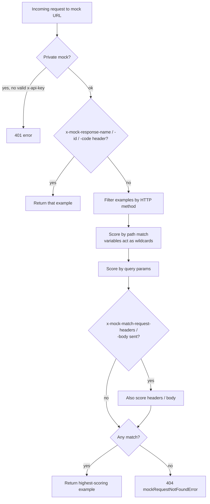

# Chapter 12 — Mock Servers, Monitors, API Design (Spec Hub), Documentation, Flows, Postman API, Insights & AI

---

## PART A — MOCK SERVERS

> 🧒 A **mock server** is a **pretend shopkeeper made of cardboard**. You ask "one apple please" and it always hands you the plastic apple you gave it earlier. Useful when the real shopkeeper (backend) hasn't arrived yet.

### 12.1 Why mocks?
- **Frontend/mobile teams** build UI before backend is ready (parallel development).
- **Design-first**: agree on the contract via examples/spec, then mock it.
- **Testing edge cases** that are hard to reproduce: 500 errors, timeouts, empty lists, huge payloads.
- **Isolating dependencies**: third-party APIs that cost money / have rate limits / no sandbox.
- **Demos and onboarding**.

### 12.2 Creating a mock server
1. Collection `...` → **Mock collection** (or sidebar → Mock servers → `+`), or create from a request's examples, or from a spec.
2. Choose collection (and version/spec), name, **environment** (optional; to resolve variables in examples), **Make mock server private** (requires API key), **Simulate fixed network delay**, and optionally **save the mock URL as an environment variable**.
3. Get URL like `https://<mock-id>.mock.pstmn.io`.
4. Set `{{baseUrl}}` in a "MOCK" environment to this URL → the same collection now hits the mock.

### 12.3 How a Postman mock decides what to return (matching algorithm)



The mock looks at **saved examples** in the collection. For an incoming request it:
1. Filters examples by **HTTP method**.
2. Matches the **URL path** (examples using variables like `{{orderId}}` or `:orderId` act as wildcards for that segment) and **query parameters** (closer matches score higher).
3. Optionally matches **headers** (if request has `x-mock-match-request-headers: header1,header2`) and **body** (if request has `x-mock-match-request-body: true`).
4. Picks the **highest-scoring** example; if none matches → 404 error JSON ("mockRequestNotFoundError").

### 12.4 Control headers (send these in your request to the mock)
| Header | Effect |
|---|---|
| `x-api-key: <Postman API key>` | Required for **private** mocks |
| `x-mock-response-name: <example name>` | Return the example with this name |
| `x-mock-response-id: <example id>` | Return example by id |
| `x-mock-response-code: 404` | Return an example with this status code |
| `x-mock-match-request-body: true` | Include body in matching |
| `x-mock-match-request-headers: h1,h2` | Include those headers in matching |

Example: frontend wants to see the error UI:
```
GET {{mockUrl}}/orders/123
x-mock-response-code: 500
```

### 12.5 Dynamic mock responses
- Examples can contain **dynamic variables** (`{{$randomFirstName}}`, `{{$guid}}`, `{{$isoTimestamp}}`) → different value each call.
- Examples can use environment variables (resolved with the mock's environment).
- Recent versions support **template helpers** in example bodies to echo request data (e.g. values from path segments, query params, headers, or body) — check your version's "dynamic mock responses" docs for exact syntax.
- **Network delay simulation** (fixed delay, e.g. 2G/3G or custom ms) to test loading spinners/timeouts.

### 12.6 Mock limitations & tips
| Limitation | Tip |
|---|---|
| Stateless: POST doesn't really create anything; GET after POST returns the saved example | For stateful fakes use a local tool (WireMock, json-server, Prism, MockServer) |
| Usage limits per plan (mock calls/month) | Use local mocks for heavy automated tests |
| Matching surprises (wrong example returned) | Use `x-mock-response-name`/`-code`; make example URLs specific |
| Public mock = anyone with URL can call | Make it private if examples contain internal data |
| Doesn't validate request body against schema by default | Contract-validate with Spec Hub / Prism |

v12 also introduced **code mocks / simulations** usable from the Postman CLI (e.g. `--simulate <file>` YAML simulations; paid plans). Check docs for availability.

---

## PART B — MONITORS

> 🧒 A **monitor** is an **alarm clock robot** that wakes up every few minutes, runs your collection from Postman's cloud, and rings a bell (email/Slack) if anything breaks.

### 12.7 Creating a monitor
Collection `...` → **Monitor collection** (or sidebar → Monitors → `+`):
| Setting | Meaning |
|---|---|
| Collection & environment | What to run, with which variables |
| **Frequency** | e.g. every 5/15/30 min, hourly, daily, weekly (minimum depends on plan) |
| **Regions** | Run from multiple geographic regions (multi-region on paid plans) — detects regional outages/latency |
| **Notifications** | Email recipients on failure/errors; plus integrations (Slack, Microsoft Teams, PagerDuty, Opsgenie, Datadog, New Relic, webhooks, etc.) |
| **Retry on failure** | Re-run once before alerting (reduce false alarms) |
| **Request timeout / delay between requests** | |
| **Follow redirects / disable SSL validation** | |
| **Use static IP** (Enterprise) | So firewalls can allowlist Postman's monitor IPs |

### 12.8 Monitor results
- Dashboard: pass/fail per run, **response time graphs**, failed tests, errors, console logs, filters by region/request.
- Each run consumes **monitoring usage** (plan quota).

### 12.9 What to monitor (best practice)
- **Health/readiness endpoints** (`/health`, `/ready`).
- **Critical business flows** in **read-only** form: login → search → product details.
- **Third-party dependencies** you rely on (payment provider status, SMS API).
- **SSL certificate expiry**: Postman scripts don't expose the server certificate's expiry date, so use a dedicated certificate-expiry monitor, or call an internal endpoint that reports it.
- **SLA**: response time thresholds.
- **Never** run destructive operations in prod monitors; use dedicated **monitor test accounts** with least privilege.

### 12.10 Monitors can't reach my internal API!
Monitors run in Postman's cloud. For private/internal APIs: expose via gateway with allowlisted **static IPs** (Enterprise), use a public staging endpoint, or run the collection on a schedule **inside your network** with **Newman/Postman CLI via cron/CI** instead.

---

## PART C — API DESIGN: SPEC HUB / API BUILDER

### 12.11 Design-first vs code-first
| Design-first | Code-first |
|---|---|
| Write the **OpenAPI** contract first, review, mock, then implement | Write code, generate the spec from code (Swagger annotations, springdoc, FastAPI) |
| Parallel FE/BE work, early feedback, consistent APIs | Faster for small teams; spec often lags |
| Postman: Spec Hub → mock → generate collection → tests | Postman: import generated spec → collection |

### 12.12 OpenAPI essentials (you'll read/write these in Postman)
```yaml
openapi: 3.0.3
info:
  title: Orders API
  version: 1.2.0
servers:
  - url: https://api.shop.com/v1
paths:
  /orders/{orderId}:
    get:
      summary: Get an order
      operationId: getOrder
      tags: [Orders]
      parameters:
        - name: orderId
          in: path
          required: true
          schema: { type: integer, minimum: 1 }
      security:
        - bearerAuth: []
      responses:
        '200':
          description: OK
          content:
            application/json:
              schema: { $ref: '#/components/schemas/Order' }
              example: { id: 42, status: PAID, total: 499.0 }
        '404':
          description: Not found
components:
  securitySchemes:
    bearerAuth: { type: http, scheme: bearer, bearerFormat: JWT }
  schemas:
    Order:
      type: object
      required: [id, status, total]
      properties:
        id: { type: integer }
        status: { type: string, enum: [PENDING, PAID, SHIPPED, CANCELLED] }
        total: { type: number, format: double }
```
Key parts: `openapi`, `info`, `servers`, `paths` → operations (`get/post/...`) → `parameters` (`in: path|query|header|cookie`), `requestBody`, `responses`; `components` (`schemas`, `securitySchemes`, `parameters`, `responses`, `examples`); `security`; `tags`. OpenAPI 3.1 aligns schemas fully with JSON Schema 2020-12 (e.g. `type: [string, "null"]` instead of `nullable: true`). Swagger 2.0 is the older format (`swagger: "2.0"`, `definitions`, `basePath`).

### 12.13 Spec Hub (v11+) / APIs (API Builder)
- Create specs in **OpenAPI 2.0, 3.0, 3.1** and **AsyncAPI 2.x** (YAML/JSON), single- or **multi-file** (with `$ref` across files).
- Editor with validation, autocomplete, **visual editor** (newer versions), preview docs.
- **Linting / governance**: built-in & custom rules (Spectral-style) for naming, security schemes, descriptions, etc. Violations shown inline; CLI `postman spec lint` / `postman api lint` in CI.
- **Generate collection** from spec; keep them **in sync** (spec → collection, and two-way sync for OpenAPI 3.0 in later v11 versions).
- **Mock** from spec, **document**, **publish versions**.
- **Git integration**: connect spec to GitHub/GitLab/Bitbucket/Azure Repos branch; v12 Native Git keeps specs and collections in your repo.
- Older **API Builder** ("APIs" sidebar): an API element linking a definition + collections (docs, tests) + mocks + monitors + environments, with **versions** and **changelog**. Many companies still use it.

### 12.14 Contract testing approaches in Postman
1. **Schema validation in tests** (`pm.response.to.have.jsonSchema`) using schemas taken from the spec.
2. **Generated collections** from spec with tests, kept in sync.
3. **Spec validation features** (validate requests in collections against the spec; flags mismatches like missing required params or wrong types).
4. **Consumer-driven contracts** (Pact) are a different approach — Postman is provider-contract oriented; mention Pact for microservices if asked.

---

## PART D — DOCUMENTATION

### 12.15 Generating & publishing docs
- Every collection has auto-generated docs from: collection/folder/request **descriptions (Markdown)**, **params/headers descriptions**, **examples**, **auth** info, and **code snippets** in chosen language.
- **View documentation** inside workspace (private to team).
- **Publish**: public URL (`documenter.getpostman.com/...` or custom domain on paid plans), choose environment to show values (never secrets!), version, styling (logo, colours), SEO metadata, **Run in Postman** button.
- Keep docs updated by treating descriptions as part of PR review.

### 12.16 Writing good API docs (checklist)
- Overview: purpose, base URLs per environment, auth instructions, rate limits, error format, versioning, changelog.
- Per request: purpose, params with types/required/defaults, body fields, response fields, examples for success & errors, permissions needed.
- Getting started guide: "Fork collection → select env → get token → first call".

---

## PART E — POSTMAN FLOWS

> 🧒 Flows are **LEGO for APIs**: snap blocks together (call this API → check result → loop → send to Slack) without writing much code.

### 12.17 Concepts
- A **flow** is a canvas of **blocks** connected by wires carrying data.
- Common blocks: **Start/Trigger** (manual, HTTP request trigger, schedule, **MCP** trigger), **HTTP Request / Send Request** (uses a saved collection request or inline request), **GraphQL request**, **Evaluate** (FQL expressions or TypeScript), **If/Condition**, **Repeat/Loop/For**, **Collect**, **Select** (pick field from data), **Template** (build JSON/text), **Delay**, **Display** (table/chart/output), **Log**, **AI Request** (prompt an LLM such as OpenAI, Anthropic, Google, or OpenAI-compatible providers), **Agent** blocks in newer releases.
- **FQL (Flows Query Language)**: a JSONata-like expression language to transform data (e.g. `$.data[status="active"].email`).
- **Deploy** a flow to the Postman cloud → it gets a URL; can be triggered by webhook/HTTP, schedule, or as an **MCP server** that AI agents (Claude Desktop, VS Code, Cursor) call as a tool, with tools defined via a schema.

### 12.18 Use cases
- Orchestrate multi-API workflows for demos/PMs.
- Data migration scripts (read from API A, transform, write to API B).
- Slack bots, scheduled reports.
- Building AI agent tools on top of existing APIs.

---

## PART F — POSTMAN API (programmatic control)

### 12.19 Basics
- Base URL: `https://api.getpostman.com`
- Auth: header `X-API-Key: <your Postman API key>` (generate in Account Settings → API keys; service accounts recommended for CI). Also accepts `?apikey=` query param (avoid; leaks to logs).
- Rate limits and monthly usage limits depend on plan; responses include rate-limit headers.

### 12.20 Common endpoints
| Endpoint | Purpose |
|---|---|
| `GET /me` | Who am I (validate key) |
| `GET /workspaces`, `GET /workspaces/{id}` | List workspaces & contents |
| `GET /collections`, `GET /collections/{uid}` | List/get collections (full JSON) |
| `POST /collections?workspace={id}` | Create collection |
| `PUT /collections/{uid}` | Replace collection (careful: full overwrite) |
| `PATCH /collections/{id}` | Partial update (name/description/variables/auth/events) |
| `GET /environments/{uid}`, `PUT /environments/{uid}` | Read/update environments (e.g. rotate a token from CI) |
| `GET /mocks`, `POST /mocks` | Mocks |
| `GET /monitors`, `POST /monitors/{uid}/run` | Monitors, trigger run |
| `GET /apis`, specs endpoints | API definitions / Spec Hub |
| `POST /webhooks?workspace={id}` | Create a webhook URL that **triggers a collection run** |
| `GET /collections/{uid}/transformations` / import endpoints | Convert OpenAPI ↔ collection |
| `/audit/logs` (Enterprise) | Audit events |

### 12.21 Webhooks that trigger collections
Create via Postman API (`POST /webhooks` with collection UID) → get a URL. Any `POST` to that URL runs the collection in the cloud; the request payload is available to scripts via the global variable **`previousRequest`**:
```javascript
const payload = JSON.parse(pm.globals.get("previousRequest"));
```
Use for: "When GitHub release is published → run smoke tests", "When deployment finishes → run checks".

### 12.22 Example automation: back up all collections nightly
```bash
for uid in $(curl -s -H "X-API-Key: $POSTMAN_API_KEY" https://api.getpostman.com/collections | jq -r '.collections[].uid'); do
  curl -s -H "X-API-Key: $POSTMAN_API_KEY" "https://api.getpostman.com/collections/$uid" > "backup/$uid.json"
done
```

---

## PART G — INSIGHTS, API CATALOG, API NETWORK

### 12.23 Postman Insights
- An **agent** (Postman Insights Agent, from Postman's acquisition of Akita Software) installed in your infrastructure (e.g. Kubernetes, ECS, Linux hosts) passively **observes live API traffic** (eBPF-based) to **discover endpoints**, track **errors and latency**, and help keep collections/specs in sync with reality — without code changes.
- Good for: "We have 300 undocumented microservice endpoints — what's actually being called?"

### 12.24 API Catalog (v12) & Private API Network
- An organisation-wide **catalog of APIs**: ownership, specs, collections, CI run results (`--report-events` from Postman CLI), governance status.
- Formerly the **Private API Network** (Enterprise) — internal "app store" of APIs for discovery and reuse.

### 12.25 Public API Network
- Public workspaces from companies (Stripe, Twilio, Salesforce, PayPal, Microsoft Graph…) with **verified** badges. **Fork** their collection to start integrating quickly.

---

## PART H — AI IN POSTMAN (Postbot & Agent Mode)

### 12.26 Postbot (v10.17+/v11)
AI assistant that can: generate tests, fix failing tests, explain responses, write documentation, create visualizations, suggest request bodies, help write scripts, summarize collection runs.

### 12.27 Agent Mode (2025+, central in v12)
- Agentic AI that can perform multi-step tasks across your workspace: create/modify collections and requests, write and run tests, debug failures, create environments, set up monitors and mocks, work with Spec Hub (generate/align specs), and more.
- **Skills**: reusable "recipes" for common tasks, invoked by typing `/` in the chat.
- Uses **AI credits** (plan dependent). Enterprise admins can control AI features.
- Treat output as a **draft**: review tests (they may encode current bugs as expectations), never paste secrets/PII into prompts unless your org's AI policy permits.

### 12.28 Postman & MCP (Model Context Protocol)
- Postman supports testing **MCP servers** (MCP client request type in recent versions), building MCP servers with **Flows (MCP trigger)**, and an official **Postman MCP server** that lets AI agents (Claude, Cursor, VS Code Copilot…) interact with your Postman workspace (collections, environments, specs) via tools.
- Interview angle: "How would you test an MCP server?" → list tools, call each tool with valid/invalid args, check JSON-RPC responses/errors, auth, timeouts — Chapter 13.

---

## 12.29 Chapter 12 Quick Revision
- Mocks return saved **examples**; matching by method → path → query → (headers/body if asked); control with `x-mock-response-name/-code/-id`, private via `x-api-key`. Stateless!
- Monitors: cloud scheduled runs, regions, alerts, retries; can't reach private networks without static IPs/allowlisting.
- Spec Hub: OpenAPI 2.0/3.0/3.1 & AsyncAPI, linting, generate & sync collections, Git.
- Docs auto-generated from descriptions/examples; publish carefully.
- Flows: visual blocks, FQL, deploy, MCP trigger, AI blocks.
- Postman API: `api.getpostman.com`, `X-API-Key`, webhooks trigger collection runs (`previousRequest`).
- Insights (traffic discovery), API Catalog (v12), Postbot & Agent Mode (AI).

➡️ Next: **Chapter 13 — GraphQL, gRPC, WebSocket, Socket.IO, MQTT, SOAP, SSE, MCP & AI requests**.
