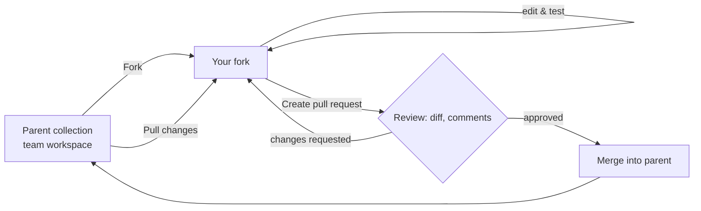

# Chapter 14 — Collaboration, Version Control & Organising Large Projects

> 🧒 When you build a giant LEGO castle alone, you can be messy. When **50 kids** build it together, you need **rules**: who builds which tower, where the pieces are kept, and that nobody smashes someone else's tower without asking.

---

## 14.1 Collaboration features
| Feature | Use |
|---|---|
| **Team workspaces** | Shared home for a product/domain |
| **Roles** (workspace & element level) | Admin / Editor / Viewer; restrict who edits prod environments |
| **Comments** | On collections, folders, requests, and even specific lines/fields; `@mention` teammates; resolve threads |
| **Forks & pull requests** | Safe changes with review, diff, approval, merge |
| **Watch** | Notifications on changes |
| **Changelog / activity feed / version history** | Who changed what; restore previous versions |
| **Share links & invite** | Give access by email/link |
| **Partner workspaces** (Enterprise) | Collaborate with external vendors securely |
| **Groups** (Enterprise) | Manage permissions by team groups synced via SCIM |
| **API Catalog / Private API Network** | Discover internal APIs |
| **Notifications/integrations** | Slack/Teams updates on collection changes, monitor failures |

---

## 14.2 Version control options

### Option A — Inside Postman (forks/PRs/version history)



- Fork → change → PR → review → merge.
- Collection **version history/changelog**: restore.
- **Tags/releases** on APIs (API Builder versions).

### Option B — Git integration (v10/v11)
- Link an **API (Spec Hub / API Builder)** to a GitHub/GitLab/Bitbucket/Azure DevOps repo branch; push/pull spec and linked collections.
- Code review happens in Git; Postman shows sync status.

### Option C — Native Git (v12)
- Workspace connected to a Git repository; **collections stored as YAML (Collection v3)**, split into multiple files under a `postman/` folder; specs alongside code.
- Work **locally** (even offline), commit, open Git PRs; CI runs `postman collection run <path>` and `postman workspace push` to sync to cloud.
- Pros: real diffs, branch per feature, tests live with code, code owners review API changes.
- Rule: local files are the source of truth; avoid editing the same items in cloud view.

### Option D — Manual export to Git (legacy, still very common)
- Export JSON v2.1, commit; Newman runs from files.
- Problems: big unreadable diffs, merge conflicts in a single JSON file, stale copies. Mitigate with normalisation scripts and **single owner per collection**.

| Option | Best for |
|---|---|
| Forks/PRs | Teams living inside Postman |
| Git integration | Spec-first teams on v10/v11 |
| Native Git | Developer-centric teams on v12 |
| Manual export | Small/legacy setups, open-source pipelines |

---

## 14.3 Workspace strategy for a big organisation

```
Team: ACME Corp
├── 🏢 Platform – Auth API            (team workspace, owned by Identity team)
├── 🏢 Commerce – Orders API          (team workspace, owned by Orders team)
├── 🏢 Commerce – Payments API        (team workspace)
├── 🧪 QA – E2E Regression            (team workspace: cross-service E2E collections, references others)
├── 🤝 Partner – Logistics Vendor X   (partner workspace)
├── 🌍 ACME Public APIs               (public workspace: published docs & collections)
└── 👤 Personal workspaces            (individual scratch work)
```

Rules:
1. **One owner team per workspace**; description lists owners, Slack channel, on-call.
2. **Reference collection per service** (generated from OpenAPI, documentation-grade) + **test collections** (smoke, regression, negative, E2E).
3. **Environments per stage per service**: `Orders – DEV/QA/STAGE/PROD` with identical variable names.
4. **Prod environments** restricted (Viewer for most; secrets in Vault/CI only).
5. **Fork for changes** to shared/critical collections; PR review by owners.
6. **No personal stuff** in team workspaces; no team assets only in personal workspaces (bus factor!).
7. **Archive** deprecated collections (rename with `[DEPRECATED]`, move to an archive workspace).

---

## 14.4 Naming conventions
| Element | Convention | Example |
|---|---|---|
| Workspace | `<Domain> – <Service> API` | `Commerce – Orders API` |
| Collection | `<Service> API – <Purpose>` | `Orders API – Regression` |
| Folder | Number prefix for order + area | `01 - Orders`, `99 - Teardown` |
| Request | `<METHOD> <what> [- condition (status)]` or human sentence | `POST Create order`, `POST Create order - empty cart (400)` |
| Environment | `<Service> – <STAGE>` | `Orders – QA` |
| Variables | camelCase, descriptive | `ordersBaseUrl`, `customerId` |
| Examples | `<status> <scenario>` | `200 OK`, `404 Order not found` |
| Tests | `<Thing> <expectation>` | `Status is 201`, `total equals sum of items` |

---

## 14.5 Collection design standards (template for a team "Postman Guidelines" doc)
1. **Collection description**: purpose, owners, how to run, required environment variables, test data assumptions.
2. **Auth at collection level**, requests inherit.
3. **Base URL variable** always; never hard-coded hosts.
4. **Every request has**: description, at least status + schema tests, examples for main status codes.
5. **Setup/Teardown folders**; tests independent & idempotent.
6. **No secrets** in shared values/scripts; Vault/CI secrets only.
7. **Shared helpers** in Package Library; no copy-paste of 50-line scripts.
8. **No `console.log` of tokens/PII**.
9. **Use IDs for setNextRequest**.
10. **Lint & review**: PR checklist (below).

### Pull request review checklist for Postman changes
- [ ] Naming conventions followed
- [ ] No hard-coded URLs/tokens/IDs
- [ ] Tests meaningful (not only status code), negative cases included
- [ ] Variables cleaned up; no globals introduced
- [ ] Scripts readable; helpers reused
- [ ] Examples & descriptions updated
- [ ] Runs green on QA environment (attach run link/report)
- [ ] No breaking changes to shared environments

---

## 14.6 Environment management at scale
- Keep a **variables dictionary** (in collection description or wiki): name, purpose, which env sets it, secret or not.
- Use **identical keys** across environments → switching env never breaks requests.
- **Runtime variables** (IDs, tokens) set by scripts → clean them up; never share them.
- **Rotate** shared credentials; prefer per-user credentials (each tester's own account) for manual work and **service accounts** for CI.
- When a variable is renamed: search & replace across collection (Find and Replace), update all environments, communicate in channel.

---

## 14.7 Onboarding a new team member (checklist)
1. Invite to team; add to workspace(s) with right role.
2. Point to "Start here" collection description.
3. They create **Vault** secrets / local values for credentials.
4. Select environment; run **Smoke** folder → all green = setup OK.
5. Read Postman guidelines doc; first change via fork + PR.

---

## 14.8 Handling common team situations

| Situation | What to do |
|---|---|
| Two people edited the same request; changes lost | Use forks + PRs for shared collections; check version history to restore |
| Someone leaked a token in a shared value / public workspace | **Revoke/rotate the secret immediately**, remove from Postman, check secret-scanner alerts, check public workspace visibility, review audit logs (Enterprise), post-mortem |
| Collection became a 2,000-request monster | Split by service/purpose; reference vs test collections; Package Library for helpers |
| Teammates' runs fail but yours pass | Compare environments (local vs shared values), Postman versions, cookies, data; share via Console logs |
| API changed (breaking) and 300 tests fail | Update spec first → regenerate/sync collection → fix tests; versioned APIs (`/v2`) → new folder/collection |
| Need to share collection with external vendor | Partner workspace or a sanitised public/forked copy; never share internal env |
| Postman outage / offline | Native Git/local files (v12), exported backups, Newman from Git |
| Person leaves company | Ensure assets are in team workspaces; transfer ownership; remove access; rotate creds they knew |
| Different Postman versions in team (UI labels differ) | Standardise version; document both label names |

---

## 14.9 Governance (Enterprise-scale)
- **API governance rules** (style guide as lint rules): naming, required descriptions, security schemes, versioning, error format.
- **API security rules**: detect missing auth, sensitive data exposure patterns in specs.
- Run linting in CI (`postman api lint` / `postman spec lint`) — fail PRs on violations.
- **Audit logs** (Enterprise): who accessed/changed/shared what.
- **SSO + SCIM** for identity lifecycle; **domain capture** to stop employees using personal Postman accounts for company work.
- **Secret scanner**: detects exposed secrets in workspaces; configure alerts.
- **Data residency** (EU data region) where required.

---

## 14.10 Chapter 14 Quick Revision
- Collaboration: team workspaces, roles, comments, forks/PRs, version history.
- Version control: in-app forks, Git integration (v10/11), Native Git YAML (v12), or manual exports.
- One owner per workspace; reference + test collections; identical env keys; no secrets in shared values.
- PR checklist; onboarding checklist; leak response = rotate first.

➡️ Next: **Chapter 15 — API Security Testing with Postman**.
