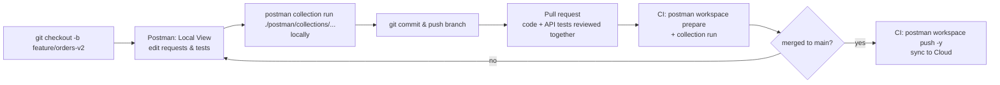

# Chapter 21 — Native Git & the Postman v12 Workflow (Deep Dive)

> 🧒 Before v12, your Postman collections lived in a **cloud locker**, and Git was a separate **photo album** where you pasted pictures (exports) now and then. In v12, the collection **lives in the photo album itself**: each request is its own page (file). Git keeps the history, and the cloud copy is synced from it.

> ⚠️ This is the newest part of Postman (v12, 2026). The concepts below come from Postman's Native Git documentation and early public examples. Command flags and file layouts can still change between minor releases, so confirm with `postman --help` and the Learning Center for your version.

---

## 21.1 Why Native Git exists

| Old pain (exports to Git) | Native Git answer |
|---|---|
| One giant `*.postman_collection.json` → unreadable diffs | Collection split into **many YAML files** (one per request), readable diffs |
| Merge conflicts in one huge JSON file | Conflicts only in the specific request files touched |
| "Which copy is latest: cloud or Git?" | **Local files are the source of truth**; the cloud is synced from them |
| API tests reviewed separately from code | Tests change in the **same pull request** as the code they test |
| Needs internet | Local-first: edit offline in **Local View** |

---

## 21.2 What gets created on disk

When you connect a workspace to a local folder (a repo, or a service folder inside a monorepo), Postman creates two directories:

```
my-service/
├── .postman/                    ← workspace configuration
│   └── resources.yaml           ← manifest: maps local files ↔ Postman Cloud entities
├── postman/                     ← your API resources (synced by push/pull)
│   ├── collections/
│   │   └── Orders API/          ← a v3 collection = a directory tree
│   │       ├── .resources/      ← collection-level definition (variables, scripts, auth) in public examples
│   │       ├── Get order.yaml   ← one file per request, scripts/tests inline
│   │       └── Create order.yaml
│   ├── environments/
│   ├── specs/
│   ├── flows/
│   ├── globals/
│   ├── mocks/
│   ├── documents/
│   └── sections.yaml
└── src/ ...                     ← your application code
```
- **Collection format v3** is YAML, split into files. The classic v2.1 is a single JSON file.
- Check that `.postman/resources.yaml` exists after connecting. If it doesn't, the connection didn't complete.
- **Commit both `.postman/` and `postman/`.** Never commit secrets (Chapter 5).

---

## 21.3 Local View vs Cloud View

| | Local View | Cloud View |
|---|---|---|
| Edits are saved to | YAML files in your folder | Postman cloud workspace |
| Reviewed through | Git pull requests | Postman forks/PRs (classic) |
| Safe to edit? | ✅ Yes, the source of truth | ⚠️ **No.** The docs warn that changes made directly in Cloud View are deleted on the next `postman workspace push`, because local files don't contain them |

> 🏢 **Team rule:** In Native Git workspaces, *everyone edits in Local View on a branch*. Treat Cloud View as read-only, for sharing, monitors and mocks.

---

## 21.4 The daily workflow



1. **Branch** from `main`.
2. In Postman, switch to **Local View** and edit requests, scripts and environments. Changes land in `postman/…` YAML files.
3. **Run locally** by path with the Postman CLI.
4. **Commit and push** the branch, then open a **PR**. Reviewers see per-request diffs next to the code change.
5. **CI** validates and runs the tests.
6. **After merge to main**, CI runs `postman workspace push` so the cloud workspace (used by teammates, monitors, mocks, docs) matches `main`.

---

## 21.5 CLI commands you'll use

```bash
postman login --with-api-key "$POSTMAN_API_KEY"

# Validate local collections/environments before CI runs them:
# checks structure, resolves references, flags problems early
postman workspace prepare

# Run a v3 collection by path (Postman CLI only)
postman collection run ./postman/collections/"Orders API" -e ./postman/environments/qa.yaml

# Push local state to the cloud workspace (-y = no interactive confirmation; use in CI)
postman workspace push -y

# Non-default resource locations
postman workspace push -y --collections-dir ./api/postman/collections --environments-dir ./api/postman/environments
```
(Use the environment file name and extension that Postman created in your repo. Run `postman workspace --help` to see the exact flags for your version.)

> ❗ **Newman cannot run v3 (YAML) collections.** Only the **Postman CLI** can. If your CI uses Newman, either keep exporting v2.1 JSON or move CI to the Postman CLI. Early v12 docs also note that **only the `cli` reporter** is supported for some v3 request types. Check before relying on JUnit/HTML output.

### GitHub Actions example (Native Git)
```yaml
name: API tests (Native Git)
on:
  pull_request:
  push:
    branches: [main]
jobs:
  api:
    runs-on: ubuntu-latest
    steps:
      - uses: actions/checkout@v4
      - name: Install Postman CLI
        run: curl -o- "https://dl-cli.pstmn.io/install/linux64.sh" | sh
      - name: Login
        run: postman login --with-api-key "${{ secrets.POSTMAN_API_KEY }}"
      - name: Validate
        run: postman workspace prepare
      - name: Run tests
        run: postman collection run "./postman/collections/Orders API" --env-var "clientSecret=${{ secrets.QA_CLIENT_SECRET }}"
      - name: Sync to cloud (main only)
        if: github.ref == 'refs/heads/main' && github.event_name == 'push'
        run: postman workspace push -y
```

---

## 21.6 Monorepos

- Create **one Postman workspace per service** and connect it to **that service's folder**, not the repo root.
- Run `postman workspace push` **from the service folder**, so the CLI reads that service's `.postman/resources.yaml` and syncs only that service.

```
monorepo/
├── services/orders/   (.postman/, postman/)  ↔ workspace "Commerce – Orders API"
├── services/payments/ (.postman/, postman/)  ↔ workspace "Commerce – Payments API"
└── .github/workflows/ (one job per service, working-directory: services/<name>)
```

---

## 21.7 Pull, conflicts, and mixed situations

- **Pulling from cloud** lets you choose which resources to bring down.
- If a local collection uses request types the cloud collection can't store, "Update existing" is disabled. You must choose **"Keep both"** or **"Rename and keep"**.
- **Git merge conflicts** are normal YAML conflicts. Resolve them in your editor, then run `postman workspace prepare` and the collection locally before pushing.
- Don't run classic forks/PRs in Postman cloud *and* Git PRs on the same collection. Pick Git as the review system.

---

## 21.8 Migrating an existing team to Native Git (playbook)

1. Pick one service and its **reference + test collections**.
2. Make sure the team is on v12 desktop and the Postman CLI.
3. Connect the workspace to the service folder, then commit `.postman/` and `postman/`.
4. Replace Newman CI jobs with Postman CLI jobs (or keep a parallel v2.1 export until reports are equivalent).
5. Announce **"edit in Local View only"**. Lock down Cloud View editing with roles where possible.
6. Add `postman workspace push -y` on merges to main.
7. After two or three sprints without issues, migrate the next service.

---

## 21.9 Interview questions on Native Git

**Q. What changed in v12 for version control?**
Collections can live in your Git repo as YAML (Collection v3), split into many files. You edit locally (Local View) and review via Git PRs, and the Postman CLI syncs to the cloud with `postman workspace push`.

**Q. Can Newman run v3 collections?** No. Use the Postman CLI, or keep exporting v2.1 JSON for Newman.

**Q. A teammate edited in Cloud View and their change disappeared. Why?**
In Native Git workspaces, local files are the source of truth. The next `workspace push` from CI removed cloud-only changes that weren't in the repo.

**Q. How do you handle a monorepo?**
One workspace per service, connected to that service's folder, with push run from that folder so the right `.postman/resources.yaml` manifest is used.

➡️ Next: **Chapter 22 — Postman Flows & FQL Deep Dive**.
