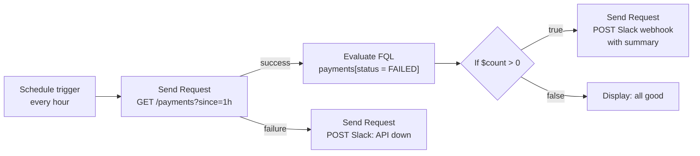

# Chapter 22 — Postman Flows & FQL (Deep Dive)

> 🧒 A flow is a **marble run**. You drop data in at the start, it rolls through tubes (wires) and gadgets (blocks): one gadget calls an API, one sorts the marbles, one says "only red marbles go left". At the end the marbles land in a bucket (output, Slack message, chart).

---

## 22.1 When to use Flows (and when not)

| Use Flows for | Prefer scripts/collections for |
|---|---|
| Visual API orchestration for demos, PMs, support teams | Regression test suites run in CI |
| Data transformation pipelines (read API A → transform → write API B) | Complex assertions and reporting |
| Scheduled automations (daily report → Slack) | Version-controlled, code-reviewed test logic (though v12 Native Git also stores flows in `postman/flows/`) |
| Exposing APIs as **AI agent tools** (MCP trigger) | |
| Prototyping integrations quickly | |

---

## 22.2 Building blocks

| Category | Blocks (names vary slightly by version) | Purpose |
|---|---|---|
| **Triggers** | Start (manual), **Request** trigger (HTTP), **Schedule**, **MCP** | How the flow starts. A deployable flow needs a trigger |
| **Requests** | HTTP/API Request (from a collection or inline), **GraphQL Request** | Call APIs |
| **Logic** | **If**, **Condition**, **Evaluate** | Branching and transformation. These accept **FQL or TypeScript** |
| **Looping/collection** | Repeat / For / Loop, **Collect** | Iterate and gather results |
| **Data** | Select, Template, Create (JSON/text/number/list), Record | Pick fields, build payloads |
| **Timing** | Delay | Wait between steps |
| **Output** | Display (table, chart, text), Log | Show results |
| **AI** | **AI Request** (OpenAI, Anthropic, Google, OpenAI-compatible providers), agent-style blocks in newer releases | Use LLMs inside flows |

Wires carry data from an output port to an input port. A **Send Request** block has **success** and **failure** outputs, so you can branch on errors.

---

## 22.3 FQL: Flows Query Language

FQL is how you **query and transform JSON** inside If, Condition and Evaluate blocks. Its syntax closely resembles **JSONata**.

> ✅ The expressions below were checked with the JSONata engine while writing this book, using the sample data shown, and they produce the results listed. Function availability in FQL can differ slightly, so use the FQL function reference in the Learning Center for your version.

Sample data (output of a "Get payments" request):
```json
{
  "customer": { "name": "Asha Rao", "email": "asha@example.com" },
  "payments": [
    { "id": 1, "description": "recurring subscription", "amount": 499,  "status": "PAID",   "date": "2026-10-01" },
    { "id": 2, "description": "one-time",               "amount": 1200, "status": "FAILED", "date": "2026-10-03" },
    { "id": 3, "description": "recurring subscription", "amount": 499,  "status": "PAID",   "date": "2026-10-08" }
  ]
}
```

| Goal | FQL expression | Result |
|---|---|---|
| Filter records | `payments[description="recurring subscription"]` | the 2 matching objects |
| Filter, then pick a field | `payments[description="recurring subscription"].amount` | `[499, 499]` |
| Single match gives a value, not an array | `payments[id=2].status` | `"FAILED"` |
| Sum | `$sum(payments[status="PAID"].amount)` | `998` |
| Count | `$count(payments)` | `3` |
| Map | `$map(payments, function($p){ $p.amount * 2 })` | `[998, 2400, 998]` |
| Filter with a function | `$filter(payments, function($v, $i, $a){ $v.amount > 500 }).id` | `2` |
| Reduce | `$reduce(payments.amount, function($acc, $v){ $acc + $v }, 0)` | `2198` |
| Reshape each item | `payments.{ "paymentId": id, "rupees": amount, "ok": status = "PAID" }` | array of new objects |
| Build an object | `{ "name": customer.name, "total": $sum(payments.amount), "failed": $count(payments[status="FAILED"]) }` | `{"name":"Asha Rao","total":2198,"failed":1}` |
| Variables (`:=`, wrap in parentheses) | `( $paid := payments[status="PAID"]; { "paidCount": $count($paid), "withGst": $sum($paid.amount) * 1.18 } )` | `{"paidCount":2,"withGst":1177.64…}` |
| Conditional | `$count(payments[status="FAILED"]) > 0 ? "ALERT" : "OK"` | `"ALERT"` |
| Strings | `$uppercase($substring(customer.name, 0, 4)) & "-" & $join(["a","b"], "-")` | `"ASHA-a-b"` |
| Lookup a key | `$lookup(customer, "email")` | `"asha@example.com"` |
| Sort | `$sort(payments, function($l, $r){ $l.amount > $r.amount }).id` | `[1, 3, 2]` |
| Distinct | `$distinct(payments.description)` | 2 unique values |
| Comments | `/* total */ $sum(payments.amount)` | `2198` |
| Today's date | `$fromMillis($toMillis($now()), "[Y0001]-[M01]-[D01]")` | e.g. `"2026-10-16"` |

> ⚠️ **Floating point:** `withGst` came out as `1177.6399999999999`. Round money with `$round(x, 2)`.

### TypeScript in Evaluate blocks
When logic gets complicated, switch the Evaluate block to **TypeScript** and write normal code against the block's inputs. Use FQL for queries and reshaping, and TypeScript for real algorithms.

---

## 22.4 Worked example: failed-payment alert flow


1. **Schedule** trigger: hourly.
2. **Send Request**: saved collection request `GET {{baseUrl}}/payments?since=1h`.
3. **Evaluate (FQL)**: `payments[status="FAILED"].{ "id": id, "amount": amount }`
4. **If**: `$count(input) > 0`
5. **Send Request**: Slack webhook body built with a Template block: `{"text": "⚠️ {{count}} failed payments in the last hour"}`
6. **Deploy** the flow, so it runs in the Postman cloud on schedule.

---

## 22.5 Flows as MCP servers (AI agents)

- Switch a flow's trigger to **MCP** and define a **schema of tools** the flow exposes (name, description, input parameters). Agent Mode can generate this schema.
- Once deployed, the flow has a **public URL** that MCP hosts (Claude Desktop, VS Code, Cursor) can add as a tool server.
- Example: a "get_order_status" tool that calls your internal Orders API with stored credentials and returns a clean JSON summary.
- **Security:** you are exposing API capabilities to AI agents. Expose only read-only, least-privilege operations first. Validate inputs. Don't leak secrets in outputs. Log usage.

---

## 22.6 Debugging flows
- Click a block to see its **input and output** data from the last run.
- Use **Display/Log** blocks as `console.log` equivalents.
- Test FQL on small sample data first. Remember that a filter with one match returns a **value, not an array**. This is the most common FQL surprise, because a following `$count` or loop then behaves unexpectedly. Wrap it to force an array: `[payments[id=2]]`.
- Failure outputs of request blocks must be wired, or errors silently stop that branch.

---

## 22.7 Interview questions on Flows

**Q. What are Postman Flows?** A visual, low-code tool for connecting blocks (requests, logic, loops, data, AI) to build API workflows. Flows can be deployed with HTTP, schedule or MCP triggers.

**Q. What is FQL?** Flows Query Language, a JSONata-like expression language for querying and transforming JSON in If, Condition and Evaluate blocks. TypeScript is the alternative for complex logic.

**Q. Gotcha with FQL filters?** One match returns a single object/value instead of an array, so wrap the expression in `[...]` when you need an array.

➡️ Next: **Chapter 23 — Enterprise Administration, Governance, Integrations & the VS Code Extension**.
