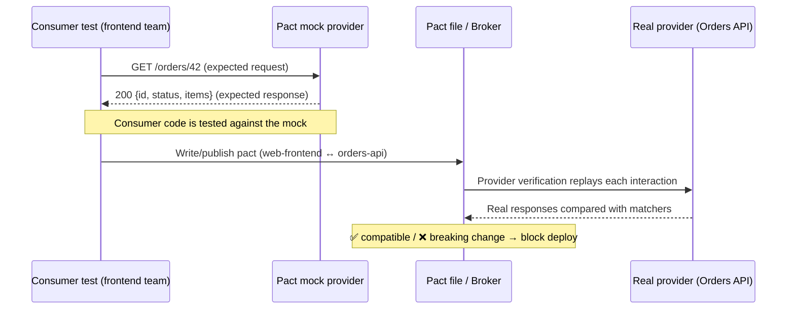

# Chapter 24 — Contract Testing with Pact (and How It Fits with Postman)

> 🧒 Two kids build a **toy train track** from opposite ends of the room. If they don't agree on *exactly* how the pieces connect, the tracks won't meet in the middle. A **contract** is the drawing of the connecting piece that both kids agree on **before** building.

---

## 24.1 Two styles of contract testing

| | **Provider-driven** (spec-first) | **Consumer-driven** (Pact) |
|---|---|---|
| Source of truth | The provider's **OpenAPI spec** | **What each consumer actually uses**, recorded as "pacts" |
| Tooling | Postman schema tests, Spec Hub validation, governance linting, Prism | **Pact** (pact.io), Pact Broker / PactFlow |
| Catches | Provider responses that don't match the spec | Provider changes that break a **specific consumer** |
| Typical owner | API/provider team | Consumer and provider teams together |
| Postman role | Central | Complementary: Postman for exploration, E2E and spec tests; Pact for fine-grained compatibility |

**Interview line:** "Schema tests in Postman verify the provider honours its published spec. Pact verifies the provider still satisfies what each consumer *actually relies on*, without both being deployed together."

---

## 24.2 How Pact works



1. **Consumer test**: the consumer defines the requests it makes and the minimal responses it needs, using **matchers** (types/patterns instead of exact values). It runs against Pact's mock server.
2. A **pact file** (JSON) is generated, and usually published to a **Pact Broker** / PactFlow.
3. **Provider verification**: the provider's CI replays every interaction against the real service, using **provider states** to set up data, and checks the responses.
4. **can-i-deploy**: the Broker tells you whether a version is safe to deploy against the versions currently in each environment.

---

## 24.3 Working example (Pact JS, verified)

> ✅ This code was **run successfully while writing this book** with `@pact-foundation/pact` 17.x on Node 22: the consumer test passed, a pact file was written, and the provider verification passed.

### Install
```bash
npm install --save-dev @pact-foundation/pact axios
```

### Consumer test — `consumer.pact.test.js`
```javascript
const path = require("path");
const assert = require("assert");
const axios = require("axios");
const { PactV3, MatchersV3 } = require("@pact-foundation/pact");
const { like, integer, eachLike, regex } = MatchersV3;

const provider = new PactV3({
  consumer: "web-frontend",
  provider: "orders-api",
  dir: path.resolve(__dirname, "pacts"),
});

(async () => {
  provider
    .given("order 42 exists")                               // provider state
    .uponReceiving("a request for order 42")
    .withRequest({ method: "GET", path: "/orders/42", headers: { Accept: "application/json" } })
    .willRespondWith({
      status: 200,
      headers: { "Content-Type": "application/json" },
      body: {
        id: integer(42),                                    // any integer
        status: regex("PENDING|PAID|SHIPPED", "PAID"),      // must match pattern
        items: eachLike({ sku: like("A1"), qty: integer(1) }) // array of ≥1 such objects
      },
    });

  await provider.executeTest(async (mockServer) => {
    // Call YOUR client code here; axios stands in for it
    const res = await axios.get(`${mockServer.url}/orders/42`, { headers: { Accept: "application/json" } });
    assert.strictEqual(res.data.id, 42);
    assert.ok(["PENDING", "PAID", "SHIPPED"].includes(res.data.status));
  });
  console.log("Consumer contract OK; pact written to ./pacts");
})().catch((e) => { console.error(e); process.exit(1); });
```
Output: `pacts/web-frontend-orders-api.json`.

### Provider verification — `provider.verify.js`
```javascript
const path = require("path");
const express = require("express");
const { Verifier } = require("@pact-foundation/pact");

// Your real provider app (here a tiny Express stand-in)
const app = express();
app.get("/orders/:id", (req, res) =>
  res.json({ id: Number(req.params.id), status: "PAID", items: [{ sku: "B7", qty: 3 }] }));

const server = app.listen(4567, async () => {
  try {
    await new Verifier({
      providerBaseUrl: "http://127.0.0.1:4567",
      pactUrls: [path.resolve(__dirname, "pacts", "web-frontend-orders-api.json")],
      stateHandlers: {
        "order 42 exists": async () => { /* insert order 42 into the test DB */ },
      },
    }).verifyProvider();
    console.log("Provider honours the contract");
  } catch (e) {
    console.error("Contract broken:", e.message);
    process.exitCode = 1;
  } finally {
    server.close();
  }
});
```
Notice that the provider returned `sku: "B7", qty: 3`, values different from the consumer's examples, and verification still **passed**. **Matchers check shape and type, not exact values.** That makes contracts robust.

### Real gotcha found during verification
In a corporate or CI network with an HTTP(S) proxy, the Pact verifier (a native core) may route even `127.0.0.1` calls through the proxy, which then returns **403** ("request blocked"). The symptom is the provider "failing" with a `text/plain` body. Fix: make sure `NO_PROXY`/`no_proxy` includes `localhost,127.0.0.1`, or unset the proxy variables **for that local verification step only**.

---

## 24.4 Pact concepts to know for interviews
| Concept | Meaning |
|---|---|
| **Consumer / Provider** | API client / API server |
| **Interaction** | One request/response expectation |
| **Pact file** | JSON contract generated by consumer tests |
| **Matchers** | `like` (same type), `eachLike` (array of like), `integer`, `decimal`, `boolean`, `regex`, `datetime`, `uuid`… |
| **Provider states** | Named preconditions ("order 42 exists") set up by the provider before replay |
| **Pact Broker / PactFlow** | Stores pacts and verification results; versioning, tags/branches, environments |
| **can-i-deploy** | CLI check: is this version compatible with what's deployed? |
| **Pending pacts / WIP pacts** | Let new consumer expectations not break provider builds immediately |
| **Bi-directional contract testing** (PactFlow) | Compare consumer pacts against the provider's **OpenAPI** spec. This is where Postman/OpenAPI-based provider testing and Pact meet |

---

## 24.5 Where Postman fits in a contract-testing strategy
1. **Spec-first design** in Spec Hub, with governance linting.
2. **Postman provider tests**: generated collections plus JSON schema assertions against the spec, run in CI.
3. **Pact consumer tests** in each consumer repo, published to the Broker.
4. **Provider verification** in provider CI, plus `can-i-deploy` before release.
5. **Postman E2E/smoke** after deployment and **monitors** in production.

---

## 24.6 Interview questions

**Q. Contract testing vs integration testing?** Integration tests run real services together (slow, environment-dependent). Contract tests verify each side independently against a shared contract (fast, isolated), so they catch breaking changes earlier.

**Q. Why use matchers instead of exact values?** Providers return real, varying data. Matchers assert shape and types, so contracts don't break on harmless value changes.

**Q. What are provider states?** Named preconditions the provider sets up before replaying an interaction, e.g. seeding "order 42 exists".

**Q. How does Postman relate to Pact?** Postman covers spec-based provider validation, exploration, E2E and monitoring. Pact covers consumer-driven compatibility. Bi-directional contract testing connects them through OpenAPI.

➡️ Next: **Chapter 25 — Extending Newman: Custom Reporters & Programmatic Runs**.
