# Chapter 24 — Visual Guide (Diagrams)

> **Goal:** the most important mechanisms of the book as pictures. The diagrams are
> written in **Mermaid**, which GitHub, GitLab, many IDEs and documentation tools render
> as real diagrams. Every diagram here was rendered successfully with the Mermaid CLI.
> The flows match behaviour verified in earlier chapters (packet captures in Chapter 7,
> recovery lab in Chapter 23).

---

## 24.1 The layers

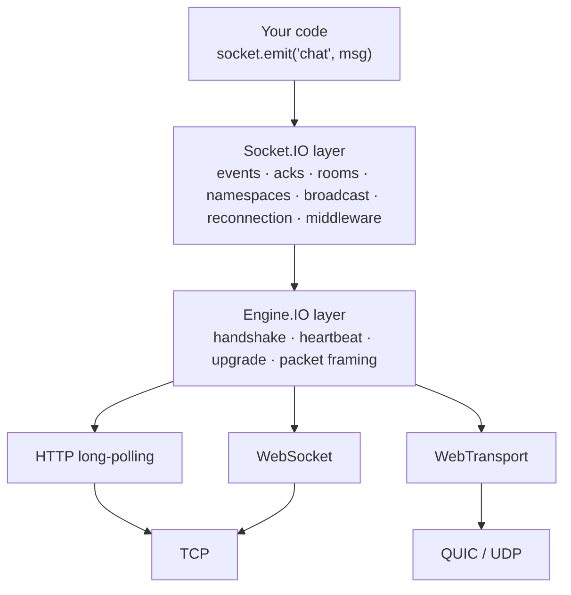

*Rendered image: [diagrams/01-layers.svg](diagrams/01-layers.svg)*

## 24.2 Connection: handshake, CONNECT and upgrade

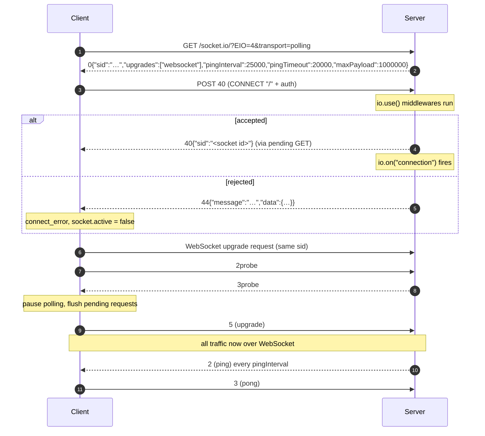

*Rendered image: [diagrams/02-handshake-upgrade.svg](diagrams/02-handshake-upgrade.svg)*

## 24.3 Event with acknowledgement

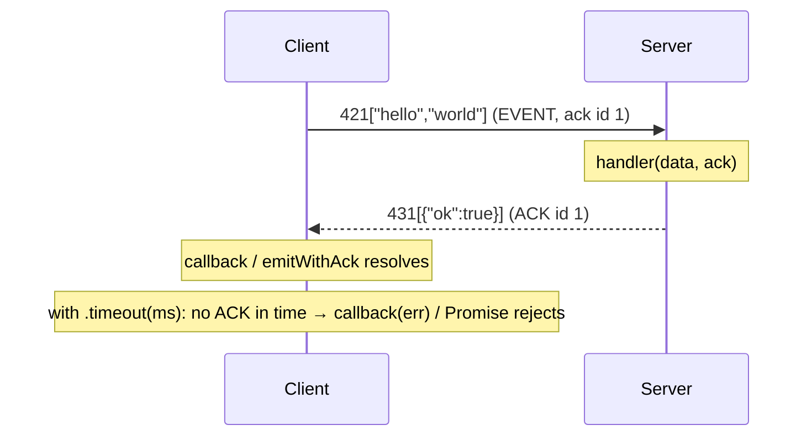

*Rendered image: [diagrams/03-event-ack.svg](diagrams/03-event-ack.svg)*

## 24.4 Client connection state machine

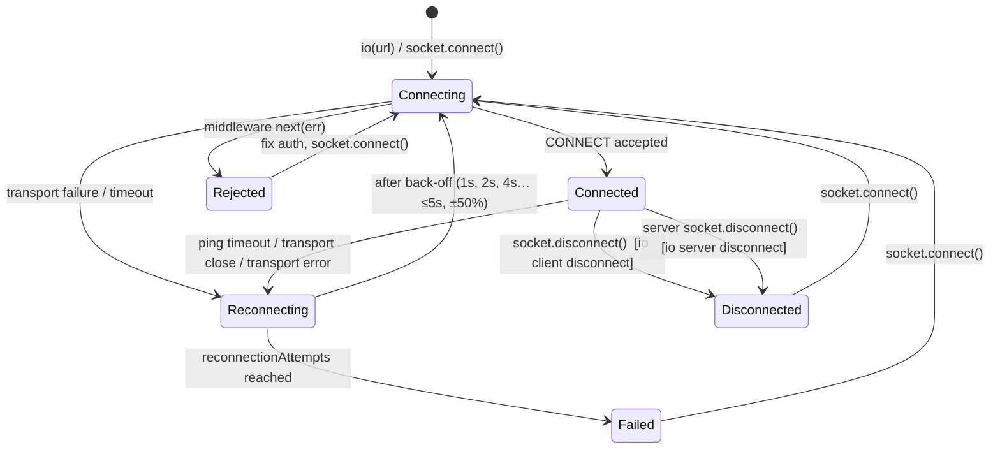

*Rendered image: [diagrams/04-client-state-machine.svg](diagrams/04-client-state-machine.svg)*

## 24.5 Heartbeat and dead-connection detection

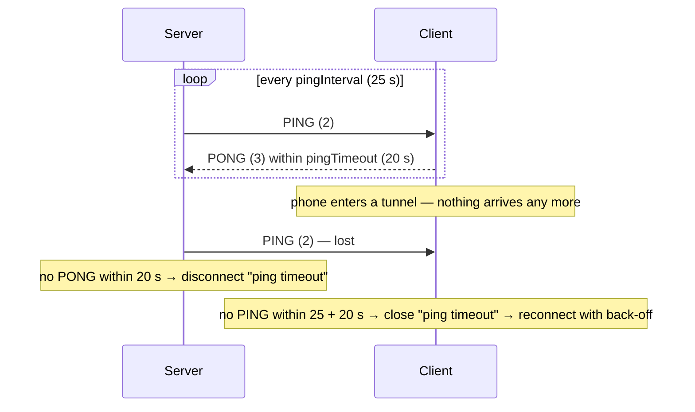

*Rendered image: [diagrams/05-heartbeat.svg](diagrams/05-heartbeat.svg)*

## 24.6 Namespaces, rooms and sockets

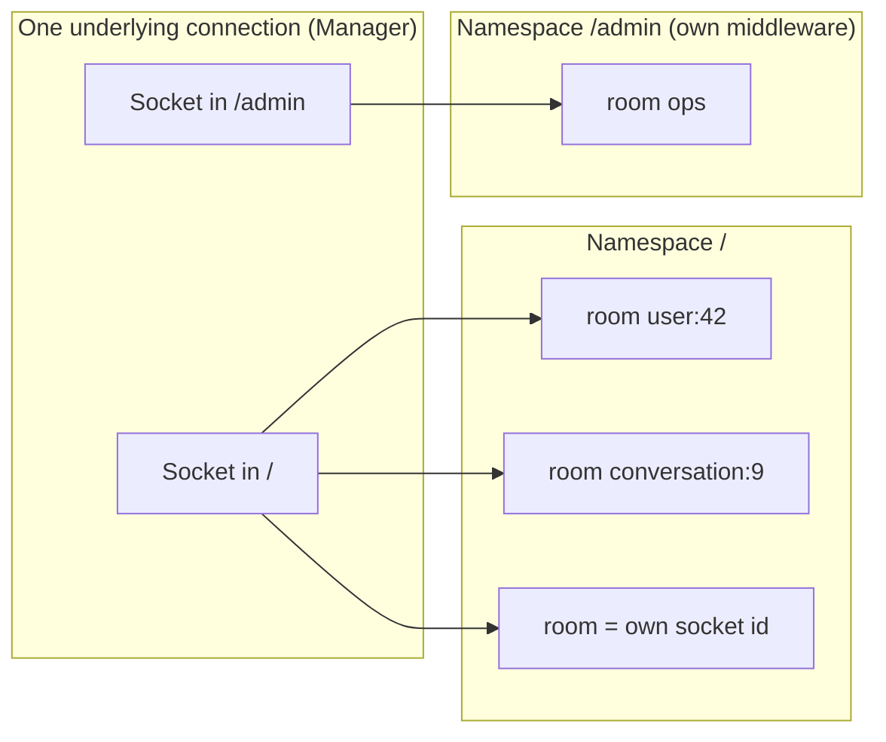

*Rendered image: [diagrams/06-namespaces-rooms.svg](diagrams/06-namespaces-rooms.svg)*

## 24.7 Broadcast targets

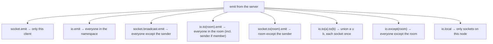

*Rendered image: [diagrams/07-broadcast-targets.svg](diagrams/07-broadcast-targets.svg)*

## 24.8 Scaling: load balancer, sticky sessions and adapter

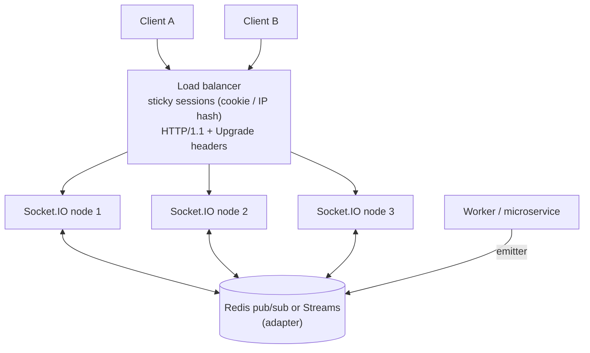

*Rendered image: [diagrams/08-scaling.svg](diagrams/08-scaling.svg)*

## 24.9 What happens without sticky sessions (verified in Lab B)

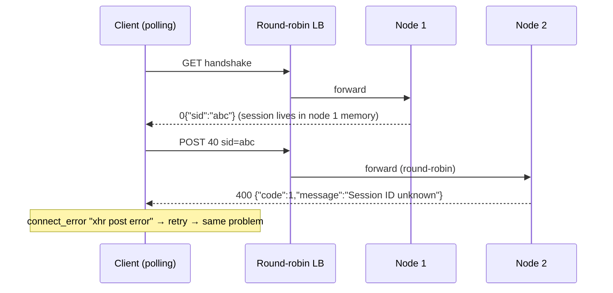

*Rendered image: [diagrams/09-no-sticky-sessions.svg](diagrams/09-no-sticky-sessions.svg)*

## 24.10 Cross-node broadcast through the adapter

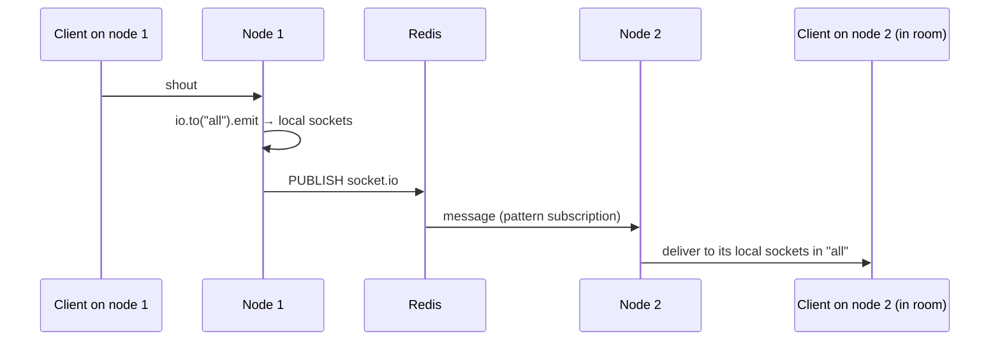

*Rendered image: [diagrams/10-adapter-broadcast.svg](diagrams/10-adapter-broadcast.svg)*

## 24.11 Connection state recovery (verified in Lab C)

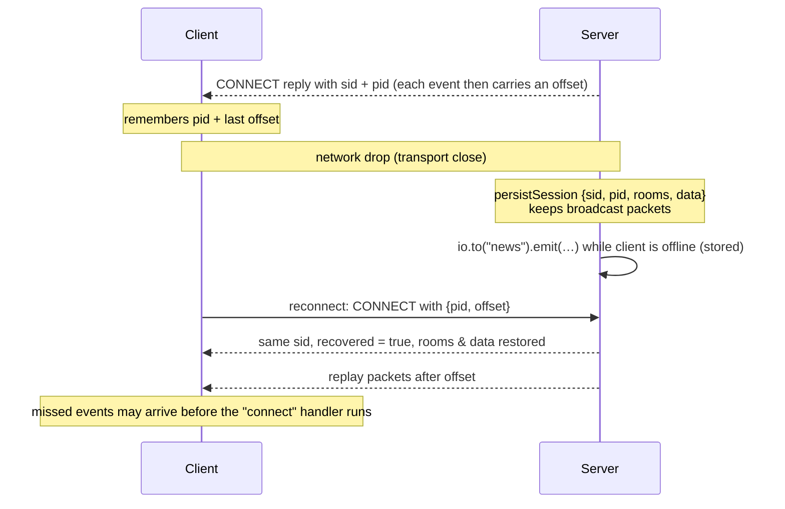

*Rendered image: [diagrams/11-connection-state-recovery.svg](diagrams/11-connection-state-recovery.svg)*

## 24.12 Chat message flow (optimistic UI, idempotency, sync)

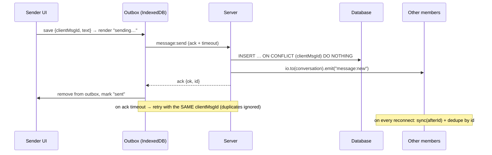

*Rendered image: [diagrams/12-chat-message-flow.svg](diagrams/12-chat-message-flow.svg)*

## 24.13 Authentication and authorization

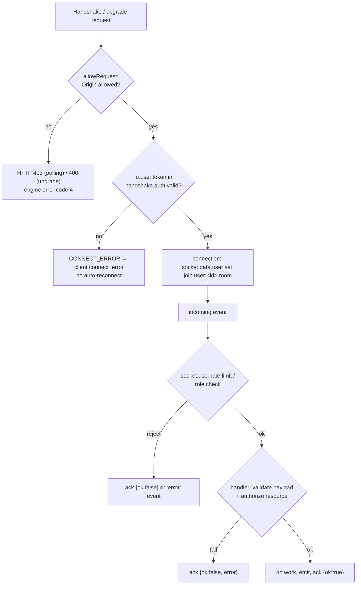

*Rendered image: [diagrams/13-auth-flow.svg](diagrams/13-auth-flow.svg)*

## 24.14 Choosing a real-time technology

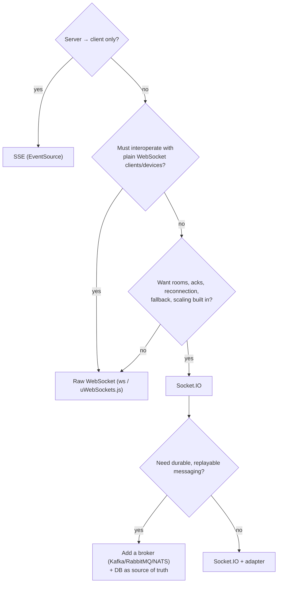

*Rendered image: [diagrams/14-choosing-technology.svg](diagrams/14-choosing-technology.svg)*

Next: back to the [table of contents](README.md).
